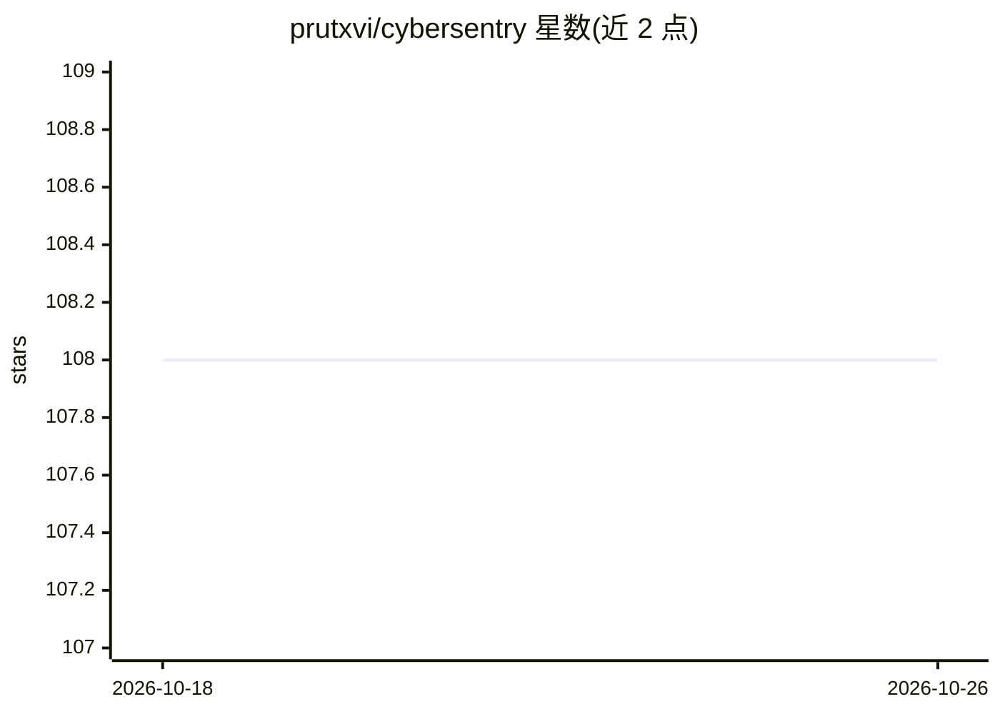

# prutxvi/cybersentry

⭐ 108 · Python · MIT · 推送 2026-08-18 · [GitHub](https://github.com/prutxvi/cybersentry) · 个人维护

**自主 AI 网站安全审计 agent，协调 8 种扫描工具生成报告**

面向授权安全测试场景的自主渗透测试 agent：以 NVIDIA NIM 上的 Llama 3.1 70B 为推理引擎，通过 ReAct 循环（Think→Act→Observe）自主决策并协调 8 种安全扫描工具（robots/sitemap 侦察、技术栈识别、HTTP 头分析、SSL 检查、Cookie 审计、目录 Fuzz、CORS 测试、Nmap 端口扫描），按 CVSS 风格评级生成 Markdown 审计报告。需 NVIDIA API key、Python 3.13+ 与 Nmap，推荐 Kali Linux 或 WSL2 Ubuntu 环境；仅限对已授权目标使用，v1.1/v2.0 功能（Docker、多 LLM、Web 面板）在路线图中未实现。

## 筛选速览

| 维度 | 判定 | 备注 |
|---|---|---|
| AI 角色 | `ai-native` | 本体是模型或模型工具 |
| 许可风险 | `permissive` | MIT |
| 部署形态 | `library` | 以包/库形式分发 |
| 模型依赖 | — | README 未给出锁定关系 |
| 硬件要求 | — | 无带数字的原话,不猜 |
| 安装摩擦 | `low` | 无编译、无系统依赖或容器化 |
| 成熟度 | — | 结构信号不足 |

## 能力要点

- ReAct 循环驱动的自主工具编排（Llama 3.1 70B via NVIDIA NIM）
- 集成 8 种安全扫描工具（含 Nmap 端口扫描、SSL 分析、目录 Fuzz）
- 生成含 CVSS 评级与修复建议的 Markdown 审计报告
- Rich 终端 UI 实时展示推理与工具执行过程

## 适用场景

- 对自有或已授权网站做自动化安全审计
- 漏洞赏金项目中辅助发现并整理常见 Web 安全问题
- 教学场景下演示 AI agent 协调安全扫描工具

## 场景标签

`网络安全` · 领域:学习与行业

## 证据(README 行号)

> L23: **CyberSentry** is an autonomous AI-powered security auditing agent designed for ethical website penetration testin
> L28: - **Autonomous Decision-Making**: Uses Llama 3.1 70B to reason about security findings and adjust scanning strategy

## 星数曲线

2026-10-18 108 → 2026-10-26 108（+0）

---
*卡片 v1 · prompt 1.4 · 生成 2026-10-23 · 置信度 mid · 依据 README sha `a262977562a2` · [字段定义](../../DATASET.md)*
