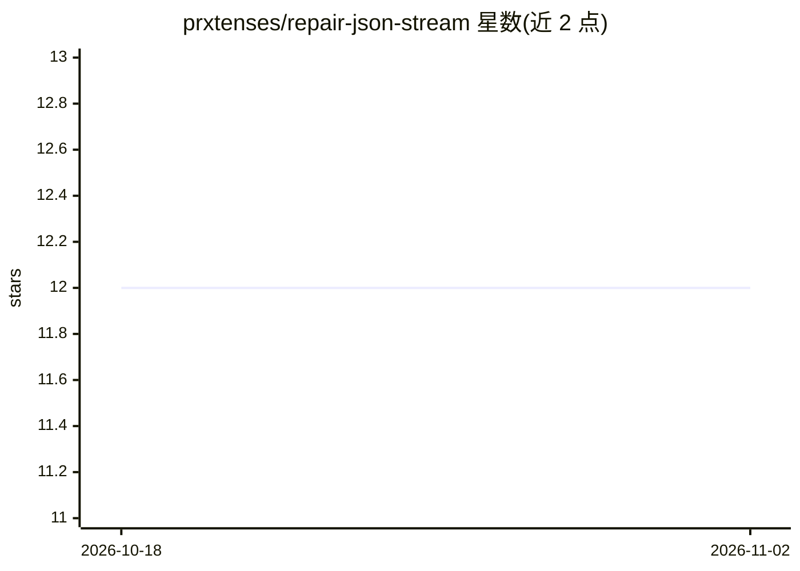

# prxtenses/repair-json-stream

⭐ 12 · TypeScript · MIT · 推送 2026-01-20 · [GitHub](https://github.com/prxtenses/repair-json-stream) · 个人维护

**修复 LLM 流式输出中不完整 JSON 的零依赖解析库**

面向 LLM 流式响应场景的 JSON 修复 npm 库：当 OpenAI/Anthropic 等模型的流式输出产生截断字符串、缺失括号、未加引号的键、Python 常量（None/True）、尾逗号、代码块围栏或 JSONP 包装时，repairJson 返回合法 JSON 且不抛异常。实现为 O(n) 单遍、基于栈的状态机，无正则解析，零依赖，压缩后 5.5 KB。提供 Node.js Transform 流、Web Streams API（Deno/Bun/Cloudflare Workers/浏览器）、CLI、增量有状态修复（IncrementalJsonRepair）以及从混杂 LLM 输出中提取 JSON 的工具。

## 筛选速览

| 维度 | 判定 | 备注 |
|---|---|---|
| AI 角色 | `ai-ecosystem` | LLM/agent 周边工具 |
| 许可风险 | `permissive` | MIT |
| 部署形态 | `library` | 以包/库形式分发 |
| 模型依赖 | — | README 未给出锁定关系 |
| 硬件要求 | — | 无带数字的原话,不猜 |
| 安装摩擦 | `low` | 无编译、无系统依赖或容器化 |
| 成熟度 | — | 结构信号不足 |

## 能力要点

- repairJson 单函数修复截断/不完整 JSON，从不抛异常
- 支持 Node.js Transform、Web Streams、CLI、浏览器全局脚本多种运行方式
- IncrementalJsonRepair 支持 push/end/snapshot/reset 的增量有状态修复
- extractJson/stripLlmWrapper 从含散文与思考块的 LLM 输出中提取 JSON

## 适用场景

- 修复 LLM 流式接口返回的截断 JSON 以便实时渲染
- 在边缘/浏览器环境中轻量解析模型输出
- 从混杂自然语言的 LLM 回复中提取 JSON 结构化数据

## 场景标签

 · 领域:LLM 工具链/数据解析

## 证据(README 行号)

> L4:  Blazing-fast JSON repair for LLM streaming
> L12: When streaming responses from LLMs like OpenAI or Anthropic, JSON often arrives incomplete:

## 星数曲线

2026-10-18 12 → 2026-11-02 12（+0）

---
*卡片 v1 · prompt 1.4 · 生成 2026-11-01 · 置信度 high · 依据 README sha `d85a26bbfb9c` · [字段定义](../../DATASET.md)*
