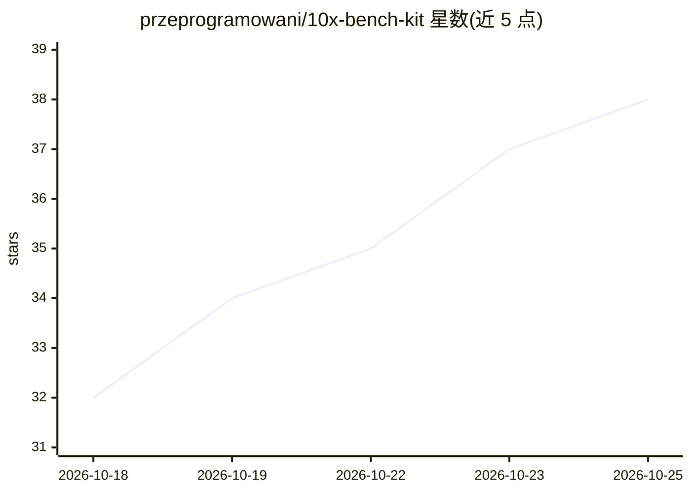

# przeprogramowani/10x-bench-kit

⭐ 38 · TypeScript · MIT · 推送 2026-10-17 · [GitHub](https://github.com/przeprogramowani/10x-bench-kit) · [官网](https://10xbench.ai) · 组织维护

**为企业构建自有编码 AI Agent 基准的模板工具**

通过 10xCLI 创建基准实例，以三个技能（bench-define/bench-measure/bench-decide）驱动工作流：从合并 PR 挖掘任务并以测试作为隐藏评分器，在隔离容器中让多个模型经 OpenCode、Claude Code、Codex CLI 三种 harness 执行，测量质量、成本与耗时，最后产出一页决策结论。执行与评估本地优先，需 Docker/Podman、Node.js 与提供商 API key。面向需要为公司选型编码模型与工具的团队。

## 筛选速览

| 维度 | 判定 | 备注 |
|---|---|---|
| AI 角色 | `ai-ecosystem` | LLM/agent 周边工具 |
| 许可风险 | `permissive` | MIT |
| 部署形态 | `None` |  |
| 模型依赖 | — | README 未给出锁定关系 |
| 硬件要求 | — | 无带数字的原话,不猜 |
| 安装摩擦 | `low` | 无编译、无系统依赖或容器化 |
| 成熟度 | — | 结构信号不足 |

## 能力要点

- PR 挖掘默认生成任务，测试即隐藏评分器
- 三种预装 harness（OpenCode/Claude Code/Codex CLI）作为模型 id 组成部分
- 执行与评估分离，保留的 attempts 可在改 rubric 后重新评估
- 成本预算上限与实际花费报告，无法定价的模型在花钱前被拒绝

## 适用场景

- 对比多个模型在自己的代码仓库任务上的通过率与成本
- 为不同类别的编程工作分别选定模型与工具
- 从团队合并 PR 批量生成真实基准任务

## 场景标签

`模型评测` · 领域:评测与运维

## 证据(README 行号)

> L3: A template for your company's AI agent benchmark. Create an instance
> L27: The benchmark measures quality, cost, and execution time. Where a CLI

## 星数曲线

2026-10-18 32 → 2026-10-25 38（+6）

---
*卡片 v1 · prompt 1.4 · 生成 2026-10-25 · 置信度 high · 依据 README sha `659e47aa4b24` · [字段定义](../../DATASET.md)*
