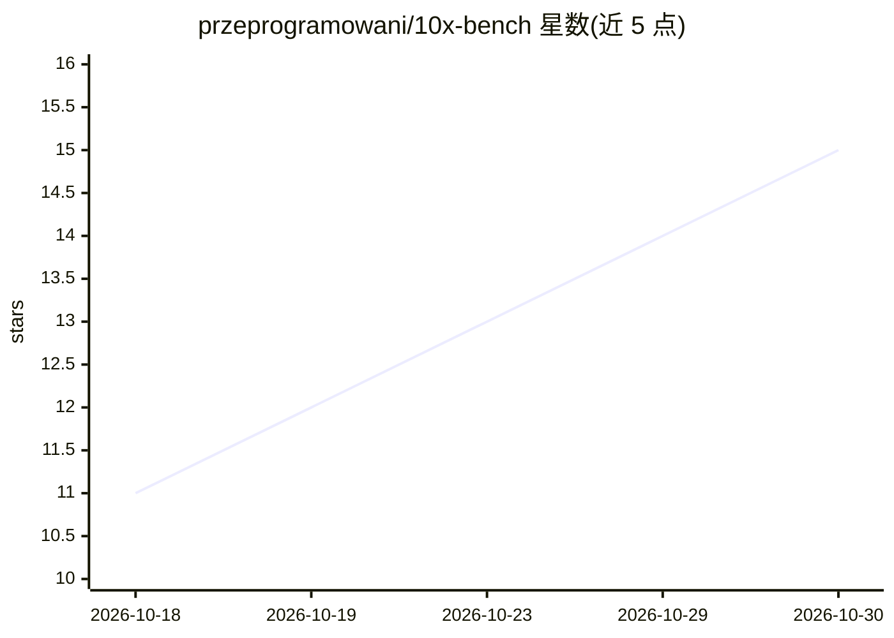

# przeprogramowani/10x-bench

⭐ 15 · Astro · MIT · 推送 2026-10-09 · [GitHub](https://github.com/przeprogramowani/10x-bench) · [官网](https://10xbench.ai/) · 组织维护

**LLM 一次性网站生成基准：多模型结果与评分看板**

评估各 LLM 在"vibe coding"任务中表现的基准仓库：让每个模型基于同一提示词与内容规范，一次性生成 Przeprogramowani.pl 网站实现，不经迭代调试。评测维度包括技术栈、页面结构、内容准确性、SEO、响应式设计、代码质量与功能。结果以 CSV 记录，经 TypeScript 脚本处理生成 JSON，由 Astro 静态站点展示交互式排行榜与截图。评分标准与提示词维护在配套仓库 10x-bench-eval。

## 筛选速览

| 维度 | 判定 | 备注 |
|---|---|---|
| AI 角色 | `ai-ecosystem` | LLM/agent 周边工具 |
| 许可风险 | `permissive` | MIT |
| 部署形态 | `library` | 以包/库形式分发 |
| 模型依赖 | — | README 未给出锁定关系 |
| 硬件要求 | — | 无带数字的原话,不猜 |
| 安装摩擦 | `low` | 无编译、无系统依赖或容器化 |
| 成熟度 | — | 结构信号不足 |

## 能力要点

- 各模型基于同一提示词做一次性网站生成实现，存于 eval-attempts 目录
- 七个维度逐项打分（技术栈/内容准确性/SEO/响应式/代码质量等），CSV 记录
- process-results.ts 解析 CSV 计算总分、百分比与模型家族均值
- Astro 静态看板展示交互式排行榜与各实现截图/filmstrip

## 适用场景

- 比较不同 LLM 一次性生成网站实现的能力
- 了解各模型在单次生成场景下的代码质量与功能完成度
- 为 AI 辅助开发工作流的技术选型提供参考数据

## 场景标签

`模型评测` · 领域:评测与运维

## 证据(README 行号)

> L5: A comprehensive benchmark comparing how different large language models tackle "vibe coding" — creating a fully func
> L9: This repository evaluates the practical capabilities of various state-of-the-art LLMs by having each model create a 

## 星数曲线

2026-10-18 11 → 2026-10-30 15（+4）

---
*卡片 v1 · prompt 1.4 · 生成 2026-10-30 · 置信度 high · 依据 README sha `e2f848e86fbc` · [字段定义](../../DATASET.md)*
