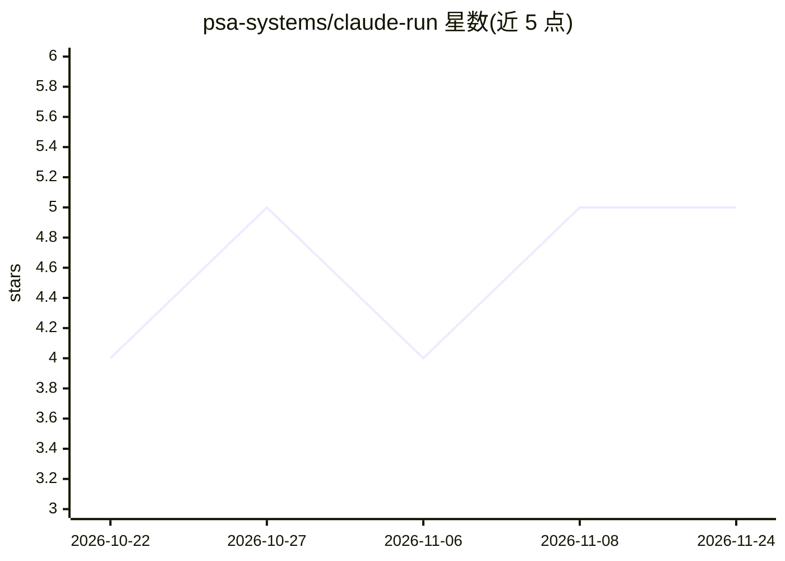

# psa-systems/claude-run

⭐ 5 · Rust · MIT · 推送 2026-11-22 · [GitHub](https://github.com/psa-systems/claude-run) · 组织维护

**YAML 驱动的 Claude Code 任务轮询运行器**

以 Docker 容器运行的 Rust 单二进制运行器：轮询 YouTrack issue、Forgejo/GitHub CI 失败、PR 评论等任意输出 JSON 数组的来源，将任务交给 `claude --print` 执行并对结果采取动作。动作以 YAML 定义（脚本型 nu 片段或原生 Rust 处理器），内置开销上限、尝试次数上限、全局暂停、受审计的 tracker 写入等护栏，状态存 SQLite 或 PostgreSQL，提供 Web UI 与 webhook 监听。拉取镜像需可读私有包的 Forgejo PAT。

## 筛选速览

| 维度 | 判定 | 备注 |
|---|---|---|
| AI 角色 | `ai-ecosystem` | LLM/agent 周边工具 |
| 许可风险 | `permissive` | MIT |
| 部署形态 | `None` |  |
| 模型依赖 | — | README 未给出锁定关系 |
| 硬件要求 | — | 无带数字的原话,不猜 |
| 安装摩擦 | `low` | 无编译、无系统依赖或容器化 |
| 成熟度 | — | 结构信号不足 |

## 能力要点

- 轮询多种来源（YouTrack、CI 失败、PR 评论等）并分发任务给 claude --print
- YAML 动作定义 + 原生 Rust 处理器两种动作类型
- 花费上限、尝试上限、全局暂停与审计写入等护栏
- 单 Rust 二进制调度、Web UI 与 webhook 监听一体

## 适用场景

- 自动处理 YouTrack issue 并把结果回写追踪器
- CI 失败后自动触发修复流程
- 根据 PR 评论触发自动化任务
- 自托管运行定时发布说明草稿或 newsletter 起草

## 场景标签

`编码 Agent` `工作流自动化` `代码审查` · 领域:效率与自动化

## 证据(README 行号)

> L3: A YAML-driven runner for Claude Code: poll a source (YouTrack issues, Forgejo or GitHub CI failures, pull request co
> L52: Built on Rust, axum, Askama, htmx and SQLx, with action snippets run by Nushell and the agent itself by Claude Code

## 星数曲线

2026-10-22 4 → 2026-11-24 5（+1）

---
*卡片 v1 · prompt 1.4 · 生成 2026-11-21 · 置信度 high · 依据 README sha `21d5a49f8a06` · [字段定义](../../DATASET.md)*
