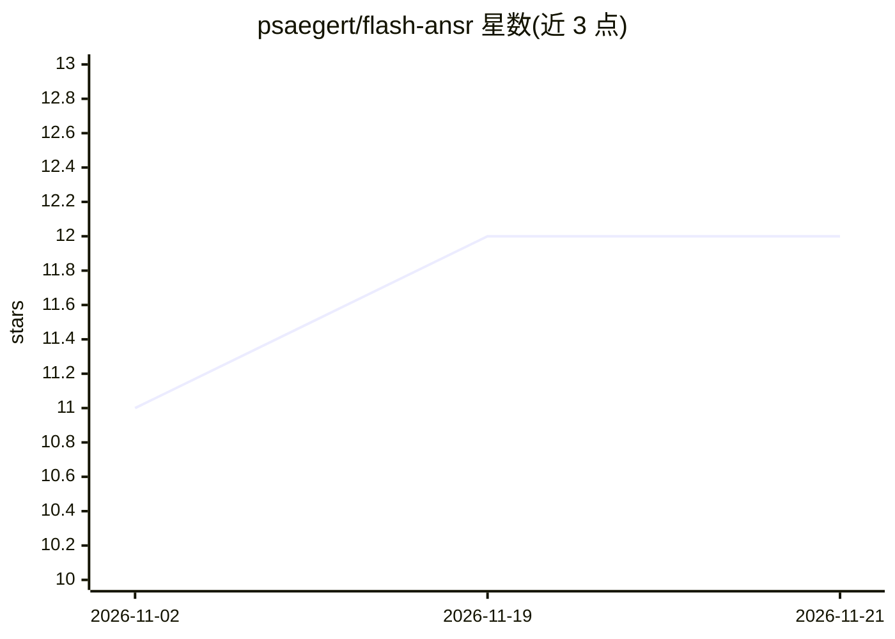

# psaegert/flash-ansr

⭐ 12 · Python · MIT · 推送 2026-11-20 · [GitHub](https://github.com/psaegert/flash-ansr) · 个人维护

**表格数据符号回归库：预训练模型直接拟合出符号表达式**

提供摊销式神经符号回归的 Python 库：加载预训练 Set Transformer 模型后调用 fit(X, y)，从表格数据恢复符号表达式，也可自行训练模型。fit 返回按分数排序的候选表达式集合（含常数、fvu、MDL 等）与完整生成记录，支持免重拟合的重新排序与序列化保存。默认启用 KV-cache、自适应批量等推理加速；提供与 PySR 的混合搜索模式（HybridRegressor）。需要 Python >= 3.12，预训练检查点提供 3M/20M/120M 三档以匹配不同硬件。

## 筛选速览

| 维度 | 判定 | 备注 |
|---|---|---|
| AI 角色 | `ai-native` | 本体是模型或模型工具 |
| 许可风险 | `permissive` | MIT |
| 部署形态 | `library` | 以包/库形式分发 |
| 模型依赖 | — | README 未给出锁定关系 |
| 硬件要求 | — | 无带数字的原话,不猜 |
| 安装摩擦 | `low` | 无编译、无系统依赖或容器化 |
| 成熟度 | — | 结构信号不足 |

## 能力要点

- 加载预训练模型后 fit(X, y) 即输出候选符号表达式及 MDL/加权/Pareto 三种排序
- HybridRegressor 用 Flash-ANSR 候选作为 PySR 进化搜索的种子
- KV-cache、静态解码、预算自适应批量的推理加速默认启用
- 提供 3M/20M/120M 三档预训练检查点

## 适用场景

- 从表格数据自动发现符号表达式
- 与 PySR 结合做混合符号回归搜索
- 在 CPU/GPU 不同算力条件下选择模型规模

## 场景标签

`科研工具` · 领域:学习与行业

## 证据(README 行号)

> L11: Flash-ANSR is a library for **amortized neural symbolic regression**: load a pretrained model, call `fit(X, y)`, an
> L116:  Flash-ANSR model architecture. The Set Transformer [Lee et al. 2019] encoder ingests a variable-sized set of inpu

## 星数曲线

2026-11-02 11 → 2026-11-21 12（+1）

---
*卡片 v1 · prompt 1.4 · 生成 2026-11-18 · 置信度 high · 依据 README sha `dd1bfb245d36` · [字段定义](../../DATASET.md)*
