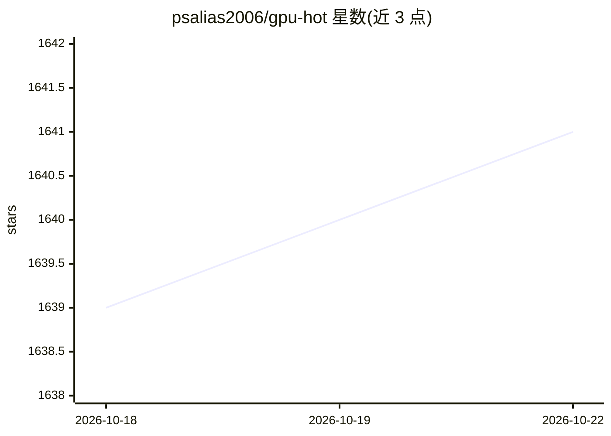

# psalias2006/gpu-hot

⭐ 1,642 · JavaScript · MIT · 推送 2026-08-25 · [GitHub](https://github.com/psalias2006/gpu-hot) · [官网](https://psalias2006.github.io/gpu-hot/) · 个人维护

**自托管实时 NVIDIA GPU 监控仪表盘（Web）**

轻量级 Web 仪表盘，通过 Docker 部署，读取 NVIDIA GPU 的利用率、温度、显存、功耗、风扇转速、时钟频率、PCIe、编码/解码会话等指标并实时展示，含历史图表与进程监控（PID、内存），另报 CPU/RAM 系统指标。支持单机与多机集群模式（hub 节点聚合，hub 本身无需 GPU），可扩展到 100+ GPU；对老 GPU 可切 nvidia-smi 模式。无客户端连接时自动暂停轮询以降低 CPU 占用。依赖 Docker + NVIDIA Container Toolkit。

## 筛选速览

| 维度 | 判定 | 备注 |
|---|---|---|
| AI 角色 | `ai-enhanced` | 去掉 AI 部分产品仍成立 |
| 许可风险 | `permissive` | MIT |
| 部署形态 | `self-host` | docker 或自建部署 |
| 模型依赖 | — | README 未给出锁定关系 |
| 硬件要求 | — | 无带数字的原话,不猜 |
| 安装摩擦 | `low` | 无编译、无系统依赖或容器化 |
| 成熟度 | — | 结构信号不足 |

## 能力要点

- 亚秒级实时指标与历史图表（利用率/温度/功耗/时钟等）
- 单机与 hub 多节点集群模式，hub 无需 GPU，可扩展 100+ GPU
- 进程监控（PID、内存）与系统指标（CPU/RAM）
- 提供 HTTP API 与 WebSocket 数据接口

## 适用场景

- 监控训练/推理服务器的 GPU 利用率与温度
- 用一台 hub 机器聚合查看多台 GPU 服务器状态
- 排查 GPU 进程占用与降频/节流状态

## 场景标签

 · 领域:运维/监控

## 证据(README 行号)

> L3: Real-time NVIDIA GPU monitoring dashboard. Lightweight, web-based, and self-hosted.
> L51: - Real-time metrics (sub-second)

## 星数曲线

2026-10-18 1,639 → 2026-10-22 1,641（+2）

---
*卡片 v1 · prompt 1.4 · 生成 2026-10-21 · 置信度 high · 依据 README sha `0a28ba0483ab` · [字段定义](../../DATASET.md)*
