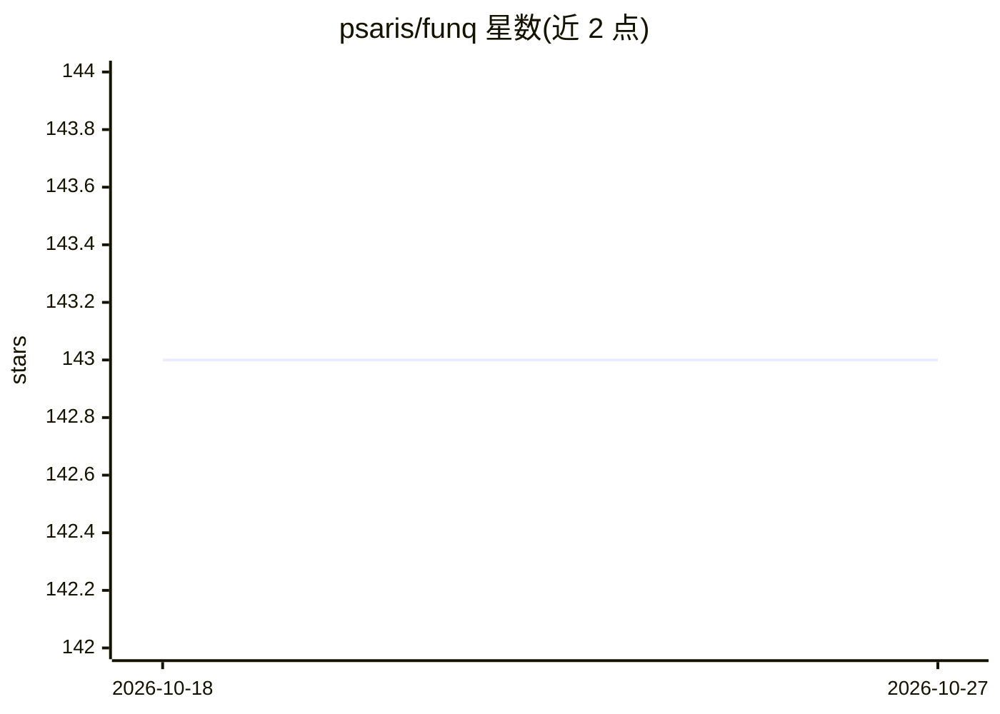

# psaris/funq

⭐ 143 · q · MIT · 推送 2026-05-17 · [GitHub](https://github.com/psaris/funq) · [官网](https://fun-q.net) · 个人维护

**机器学习入门书籍《Fun Q》的 q 语言源码集合**

收录《Fun Q: A Functional Introduction to Machine Learning in Q》一书的配套源码，用 kdb+ 的 q 语言实现 KNN、K-Means、层次聚类、EM、朴素贝叶斯、决策树、AdaBoost、随机森林、线性/逻辑回归、神经网络、推荐系统与 PageRank 等算法，各算法以独立 q 脚本提供，可用 q 解释器加 4 个次级线程并行运行。运行前需从 Kx Systems 下载页安装 q。书籍本身在 Amazon 与 Kindle 销售，勘误收录后并入新版印刷。

## 筛选速览

| 维度 | 判定 | 备注 |
|---|---|---|
| AI 角色 | `ai-knowledge` | 知识聚合/清单类 |
| 许可风险 | `permissive` | MIT |
| 部署形态 | `None` |  |
| 模型依赖 | — | README 未给出锁定关系 |
| 硬件要求 | — | 无带数字的原话,不猜 |
| 安装摩擦 | `low` | 无编译、无系统依赖或容器化 |
| 成熟度 | — | 结构信号不足 |

## 能力要点

- q 语言实现十余种经典机器学习算法脚本
- 每个算法提供独立脚本与示例运行命令
- 支持以 -s 4 启动次级线程并行计算

## 适用场景

- 配合《Fun Q》书籍学习 q 语言机器学习实现
- 在 kdb+ 环境中运行 KNN、聚类、回归等算法示例
- 查阅 tf-idf、推荐系统、PageRank 等算法的函数式实现

## 场景标签

`教程课程` · 领域:学习与行业

## 证据(README 行号)

> L3: This project contains the source files for "Fun Q: A Functional
> L45: Start q with any of the following or read the comments and run the

## 星数曲线

2026-10-18 143 → 2026-10-27 143（+0）

---
*卡片 v1 · prompt 1.4 · 生成 2026-10-22 · 置信度 high · 依据 README sha `37f5c5855cf1` · [字段定义](../../DATASET.md)*
