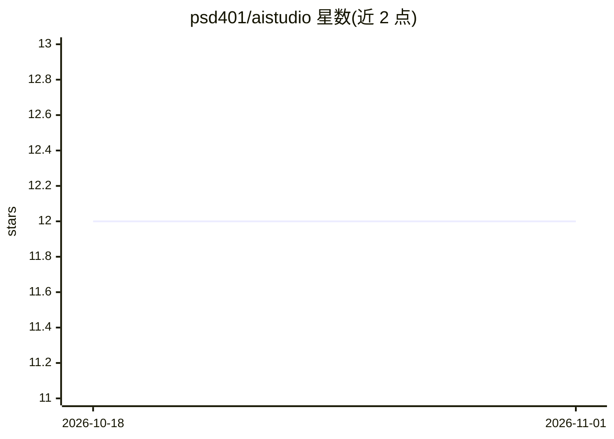

# psd401/aistudio

⭐ 12 · TypeScript · MIT · 推送 2026-10-28 · [GitHub](https://github.com/psd401/aistudio) · [官网](https://psd401.ai/aistudio) · 组织维护

**面向 K-12 教育的自托管多模型生成式 AI 平台**

由 Peninsula 学区（PSD401）开发的自托管 Web 平台，在学区自有 AWS 基础设施内为师生提供 GPT-5、Claude、Gemini、Bedrock 多模型对话、模型对比、知识库上传与语义搜索、无代码提示链自定义助手等功能；面向管理员提供 Cognito 认证与 RBAC、配额限流、CloudWatch 监控、Bedrock Guardrails 检测记录模式的安全审计及 PII/合规（COPPA/FERPA/CIPA）支持。技术栈为 Next.js 16 + ECS Fargate + Aurora + AWS CDK，通过 API/OAuth2/MCP 对外集成。需自行部署 AWS 基础设施。

## 筛选速览

| 维度 | 判定 | 备注 |
|---|---|---|
| AI 角色 | `ai-native` | 本体是模型或模型工具 |
| 许可风险 | `permissive` | MIT |
| 部署形态 | `None` |  |
| 模型依赖 | locked-api |  |
| 硬件要求 | — | 无带数字的原话,不猜 |
| 安装摩擦 | `low` | 无编译、无系统依赖或容器化 |
| 成熟度 | — | 结构信号不足 |

## 能力要点

- 多前沿模型实时切换与并排对比（GPT-5/Claude Opus/Gemini）
- 无代码可视化提示链构建自定义 AI 助手
- 文档上传 + 向量嵌入语义搜索的知识库
- REST API、OAuth2/OIDC Provider 与 MCP Server（5 个工具）对外集成
- Bedrock Guardrails 检测记录模式的内容安全与 PII 遥测

## 适用场景

- 学区在自有基础设施内为师生提供多模型 AI 对话服务
- 教师用无代码方式搭建课程定制 AI 助手
- 管理员按用户配额与用量追踪控制 AI 成本
- 通过 REST API 或 MCP 将平台能力接入外部应用

## 场景标签

`AI 助手` `聊天机器人` · 领域:对话与助手

## 证据(README 行号)

> L9: AI Studio is an open-source platform that provides K-12 educators and students with access to cutting-edge generativ
> L31: - **Multi-Model Access**: Real-time switching between GPT-5, Claude Opus, and Google Gemini
> L41: - 🤖 **Nexus Chat** - Conversational AI with multiple frontier models

## 星数曲线

2026-10-18 12 → 2026-11-01 12（+0）

---
*卡片 v1 · prompt 1.4 · 生成 2026-11-01 · 置信度 high · 依据 README sha `02e43b340b64` · [字段定义](../../DATASET.md)*
