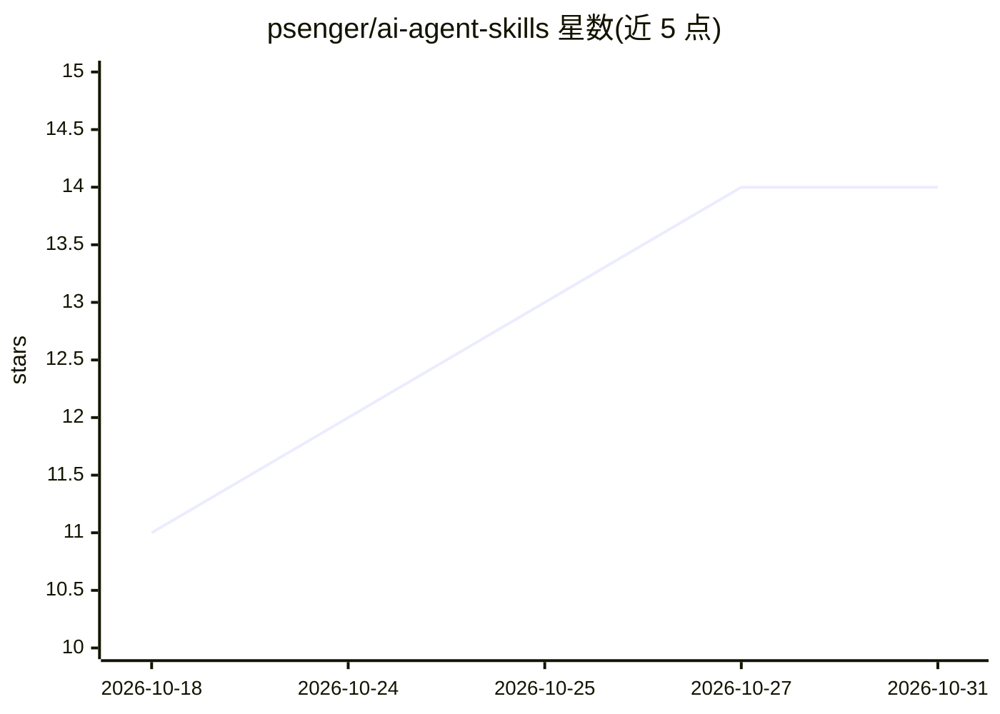

# psenger/ai-agent-skills

⭐ 14 · Python · MIT · 推送 2026-05-24 · [GitHub](https://github.com/psenger/ai-agent-skills) · 个人维护

**面向 Claude Code/Codex/Cursor 的生产级 AI agent 技能库**

一套可复用的 AI 编程 agent 技能集合，每个技能为自包含文件夹（SKILL.md + 参考资料与示例），供 Claude Code、Codex、Cursor 及支持 Agent Skills 开放标准的工具按需加载。收录 10 个技能：Obsidian 笔记转换（vault-scribe）、项目脚手架生成、Conventional Commits/PR/变更日志工作流、设计评审访谈、七步架构审查（arch-lens）、REST API 设计审查、技能创建、会话状态交接、Agent OS 配置审查与笔记导出。多为 Skills 2.0 规范声明（allowed-tools 等）。

## 筛选速览

| 维度 | 判定 | 备注 |
|---|---|---|
| AI 角色 | `ai-knowledge` | 知识聚合/清单类 |
| 许可风险 | `permissive` | MIT |
| 部署形态 | `library` | 以包/库形式分发 |
| 模型依赖 | locked-api |  |
| 硬件要求 | — | 无带数字的原话,不猜 |
| 安装摩擦 | `low` | 无编译、无系统依赖或容器化 |
| 成熟度 | — | 结构信号不足 |

## 能力要点

- 10 个自包含技能，按 Agent Skills 开放标准组织
- 覆盖笔记转换、脚手架、提交/PR 工作流、架构审查、设计评审等任务
- arch-lens 通过并行子代理生成多套接口设计并输出 RFC 文件
- git 技能含敏感内容扫描与用户确认门禁

## 适用场景

- 给 Claude Code/Codex/Cursor 添加可复用的规范化工作流技能
- 让 agent 按固定流程做架构审查或设计评审
- 统一团队的提交信息与变更日志生成流程

## 场景标签

`提示工程` · 领域:Agent 开发

## 证据(README 行号)

> L3:  A curated collection of production-ready AI agent skills
> L13: **ai-agent-skills** is a library of reusable skills that teach AI coding agents _how_ to do specialised tasks — con

## 星数曲线

2026-10-18 11 → 2026-10-31 14（+3）

---
*卡片 v1 · prompt 1.4 · 生成 2026-10-31 · 置信度 high · 依据 README sha `d8c660b5b5ef` · [字段定义](../../DATASET.md)*
