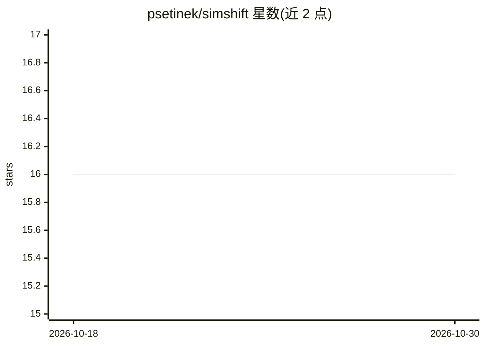

# psetinek/simshift

⭐ 16 · Python · MIT · 推送 2026-05-19 · [GitHub](https://github.com/psetinek/simshift) · [官网](https://simshift.readthedocs.io) · 组织维护

**评测物理仿真神经代理模型分布偏移适配的基准**

SIMSHIFT 是面向无监督域适配（UDA）方法的基准：提供热轧、钣金成形、电机设计、散热器设计四类基于网格的 PDE 仿真工业数据集（托管于 Hugging Face），并附 dataloader、基线模型、UDA 算法与模型选择策略及评测协议。支持自定义任意 n 维参数域划分（domain_splitter.py），提供教程 notebook（Colab）与论文结果复现说明。基于 Python/PyTorch/Hydra，以源码方式安装，需自行配置 torch、PyG、torch-scatter 等依赖。

## 筛选速览

| 维度 | 判定 | 备注 |
|---|---|---|
| AI 角色 | `ai-knowledge` | 知识聚合/清单类 |
| 许可风险 | `permissive` | MIT |
| 部署形态 | `library` | 以包/库形式分发 |
| 模型依赖 | — | README 未给出锁定关系 |
| 硬件要求 | — | 无带数字的原话,不猜 |
| 安装摩擦 | `medium` | 含编译或系统依赖之一 |
| 成熟度 | — | 结构信号不足 |

## 能力要点

- 四类工业 PDE 仿真数据集，含跨参数配置的分布偏移
- 提供基线模型、UDA 算法与模型选择策略及评测协议
- domain_splitter.py 支持任意 n 维参数的自定义域划分
- 提供教程 notebook（Colab）与论文结果复现指引

## 适用场景

- 评测无监督域适配方法在神经仿真代理上的表现
- 为物理仿真任务获取带分布偏移的工业基准数据集
- 复现论文结果或扩展新模型、数据集与域适配算法

## 场景标签

`模型评测` · 领域:评测与运维

## 证据(README 行号)

> L19: This repository contains the datasets, dataloaders, baseline models, unsupervised domain adatpation algorithms and 
> L23: - **Hot rolling**
> L28: All the datasets are hosted on Huggingface at https://huggingface.co/datasets/simshift/SIMSHIFT_data.

## 星数曲线

2026-10-18 16 → 2026-10-30 16（+0）

---
*卡片 v1 · prompt 1.4 · 生成 2026-10-30 · 置信度 high · 依据 README sha `a5105e0beb61` · [字段定义](../../DATASET.md)*
