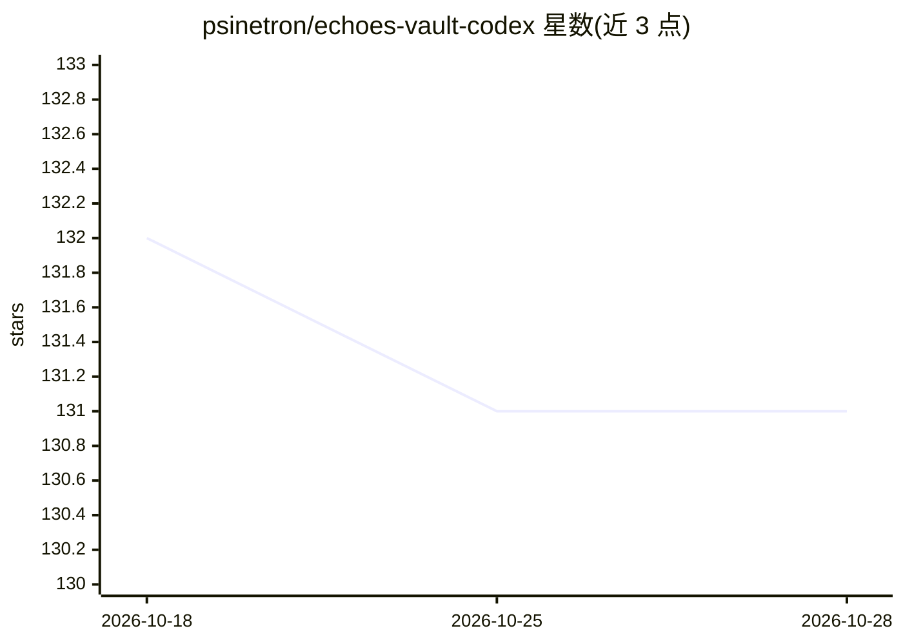

# psinetron/echoes-vault-codex

⭐ 132 · Python · MIT · 推送 2026-09-04 · [GitHub](https://github.com/psinetron/echoes-vault-codex) · 个人维护

**给编码 agent 的仓库本地持久记忆插件与可移植协议**

面向 Codex 的持久记忆插件，也是可移植的项目记忆协议：Codex 安装插件后，在仓库内初始化生成纯 Markdown 知识库、可移植 Python 引擎与各 agent 适配器；随后 Codex、OpenCode、Claude 等编码 agent 遵循同一协议读写记忆，共享校验、锁、日志与确定性索引。知识以 OKF 对齐的 Markdown 存储，可直接阅读、随 Git 提交、兼容 Obsidian。运行时无 Python 包依赖、无需 API key 与网络访问，要求 Python 3.9+。卸载插件不删除项目内的知识。

## 筛选速览

| 维度 | 判定 | 备注 |
|---|---|---|
| AI 角色 | `ai-ecosystem` | LLM/agent 周边工具 |
| 许可风险 | `permissive` | MIT |
| 部署形态 | `None` |  |
| 模型依赖 | — | README 未给出锁定关系 |
| 硬件要求 | — | 无带数字的原话,不猜 |
| 安装摩擦 | `low` | 无编译、无系统依赖或容器化 |
| 成熟度 | — | 结构信号不足 |

## 能力要点

- 生成仓库本地 Markdown 记忆库与可移植 Python 引擎，多 agent 共用同一协议与锁
- 提供 5 个技能（init/start/vault/end/status）与自然语言触发
- 无依赖 CLI：原子写入、项目锁、冲突检测、乐观并发检查
- OKF 对齐存储，兼容 Obsidian 与 Git

## 适用场景

- 让编码 agent 跨会话保留项目记忆与架构决策
- Codex/OpenCode/Claude 混用或团队协作时共享同一套项目知识
- 以纯 Markdown 形式用 Git 管理和阅读 agent 记忆

## 场景标签

`Agent 记忆` · 领域:Agent 开发

## 证据(README 行号)

> L15: EchoesVault is a persistent memory plugin for Codex and a portable project-memory protocol for
> L233: - `$echoes-init` — idempotently create or activate the vault.

## 星数曲线

2026-10-18 132 → 2026-10-28 131（-1）

---
*卡片 v1 · prompt 1.4 · 生成 2026-10-22 · 置信度 high · 依据 README sha `97a8591d9bcd` · [字段定义](../../DATASET.md)*
