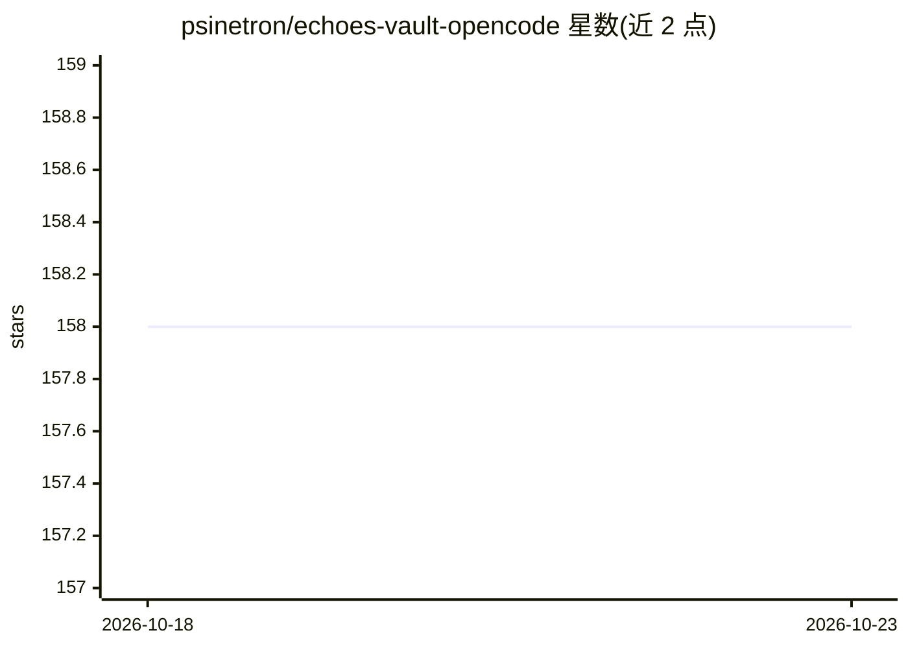

# psinetron/echoes-vault-opencode

⭐ 158 · Python · MIT · 推送 2026-09-08 · [GitHub](https://github.com/psinetron/echoes-vault-opencode) · [官网](https://www.npmjs.com/package/echoes-vault-opencode) · 个人维护

**OpenCode 插件：为 agent 提供跨会话的项目本地 Markdown 记忆库**

EchoesVault 的 OpenCode 适配器：将架构决策、验证过的修复、每日工作笔记等持久化项目知识以 Markdown 形式存放在仓库内。所有写入经由共享的 Python 运行时（.echoes-vault/echoes_vault.py），使 OpenCode、Codex、Claude Code 与脚本共享同一知识库；通过共享锁、原子替换与 SHA-256 校验防止静默覆盖，UTC 可排序的每日条目与生成式索引便于 Git 协作。安装插件本身只读不改仓库，需显式 /echoes-init 初始化。要求 OpenCode ≥1.16.0 与 Python ≥3.9，运行时无需网络服务、数据库、API key 或第三方 Python 包。

## 筛选速览

| 维度 | 判定 | 备注 |
|---|---|---|
| AI 角色 | `ai-ecosystem` | LLM/agent 周边工具 |
| 许可风险 | `permissive` | MIT |
| 部署形态 | `library` | 以包/库形式分发 |
| 模型依赖 | — | README 未给出锁定关系 |
| 硬件要求 | — | 无带数字的原话,不猜 |
| 安装摩擦 | `low` | 无编译、无系统依赖或容器化 |
| 成熟度 | — | 结构信号不足 |

## 能力要点

- 多 agent（OpenCode/Codex/Claude Code/脚本）共享单一写入运行时与知识库
- 共享锁、原子替换与 SHA-256 校验的并发写安全机制
- 知识以仓库内 Markdown 为唯一事实来源，状态文件可丢弃
- 提供 /echoes-init、/echoes-start、/echoes-status、/echoes-end 及 9 个工具

## 适用场景

- 让编码 agent 在会话之间保留和恢复项目记忆
- 多台机器克隆仓库后用 /echoes-start 恢复上下文
- 团队以 Git 协作方式积累架构决策与修复记录

## 场景标签

`Agent 记忆` · 领域:Agent 开发

## 证据(README 行号)

> L3:  An OpenCode adapter for repository-local, agent-neutral project memory.
> L12: Protocol 1.0.0: OpenCode, Codex, Claude Code, and scripts all delegate writes to the same

## 星数曲线

2026-10-18 158 → 2026-10-23 158（+0）

---
*卡片 v1 · prompt 1.4 · 生成 2026-10-22 · 置信度 mid · 依据 README sha `726a1ee647ae` · [字段定义](../../DATASET.md)*
