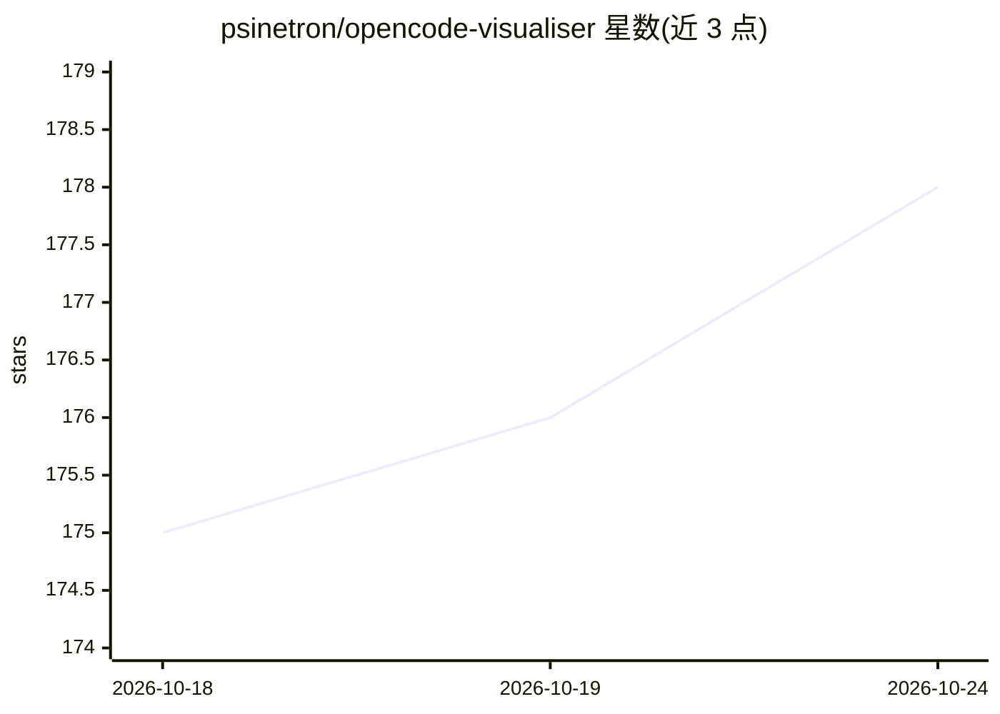

# psinetron/opencode-visualiser

⭐ 178 · HTML · MIT · 推送 2026-10-23 · [GitHub](https://github.com/psinetron/opencode-visualiser) · [官网](https://github.com/psinetron/opencode-visualiser/blob/main/README.md) · 个人维护

**把 OpenCode 终端日志可视化为 2D 像素办公室的插件**

面向 OpenCode 用户的可视化插件：读取 agent 终端日志与运行状态，将多个 agent（Explore、Scout 等）以像素小人形式呈现在共享虚拟办公室中，实时展示工具执行、文件搜索与代码编写等活动。每个 agent 随机分配皮肤并保存于 .opencode/viz-skin.json，5 个角色各有待机/行走/工作/反应动画。通过 opencode plugin 命令或 OpenCode UI 从 npm 安装，无需单独安装 Bun；运行时在 localhost:5173 启动本地服务器并打开 Chrome 应用窗口。

## 筛选速览

| 维度 | 判定 | 备注 |
|---|---|---|
| AI 角色 | `ai-ecosystem` | LLM/agent 周边工具 |
| 许可风险 | `permissive` | MIT |
| 部署形态 | `None` |  |
| 模型依赖 | — | README 未给出锁定关系 |
| 硬件要求 | — | 无带数字的原话,不猜 |
| 安装摩擦 | `low` | 无编译、无系统依赖或容器化 |
| 成熟度 | — | 结构信号不足 |

## 能力要点

- 实时可视化多个 OpenCode agent 在共享办公室中的活动
- 5 个角色各有待机/行走/工作/反应动画，皮肤可自定义
- 零依赖安装：随 OpenCode 内置 Bun 运行时执行，无需 Electron
- 服务器角色可在实例间自动接管，中断后不中断服务

## 适用场景

- 在编码时直观观察多个 agent 的工作与空闲状态
- 给 agent 配不同皮肤以区分身份
- 以轻松的像素风格监控 AI 编排过程

## 场景标签

 · 领域:开发者工具/可视化

## 证据(README 行号)

> L7: **Turning raw OpenCode terminal logs into cozy 2D pixel office chaos.** Watch your agents work, idle, and celebrate 
> L15: - **Real-time Visualization:** Watch your OpenCode agents move around their office as they execute tools, search fi

## 星数曲线

2026-10-18 175 → 2026-10-24 178（+3）

---
*卡片 v1 · prompt 1.4 · 生成 2026-10-22 · 置信度 high · 依据 README sha `0ac34414a8dd` · [字段定义](../../DATASET.md)*
