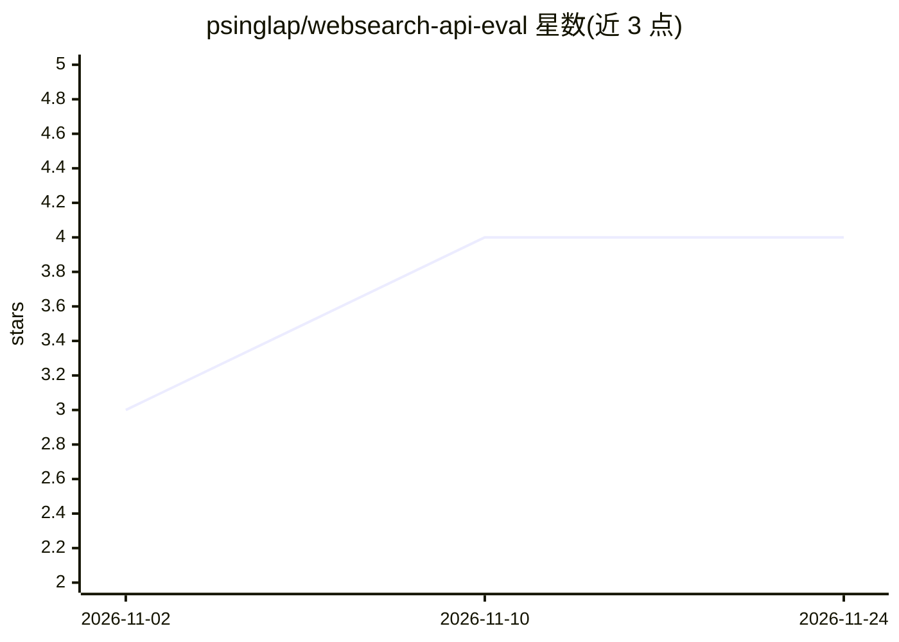

# psinglap/websearch-api-eval

⭐ 4 · HTML · MIT · 推送 2026-10-27 · [GitHub](https://github.com/psinglap/websearch-api-eval) · [官网](https://psinglap.github.io/websearch-api-eval/) · 个人维护

**AI agent 用的四款网页搜索 API 基准评测与查询工具**

对 You.com、Tavily、Exa、Parallel 四个网页搜索 API 在 30 条 agent 风格查询（GTM/保险/金融三类场景）上的横评，每 API 90 次调用，指标覆盖准确率、freshness、precision@5、延迟、token 效率与单位成本，评测用 promptfoo 运行，评分遵循 SimpleQA 与 FreshQA 规则。结果通过静态网站、只读 MCP server、npm 本地 MCP（含自配 key 的 run_live_search）、Claude Code 插件、Hugging Face 数据集与仓库内测试 harness 多渠道分发。

## 筛选速览

| 维度 | 判定 | 备注 |
|---|---|---|
| AI 角色 | `ai-ecosystem` | LLM/agent 周边工具 |
| 许可风险 | `permissive` | MIT |
| 部署形态 | `desktop` | 安装包/桌面程序 |
| 模型依赖 | — | README 未给出锁定关系 |
| 硬件要求 | — | 无带数字的原话,不猜 |
| 安装摩擦 | `low` | 无编译、无系统依赖或容器化 |
| 成熟度 | — | 结构信号不足 |

## 能力要点

- 30 条查询 × 3 次重复 = 每 API 90 次调用的横评，含准确率/新鲜度/延迟/成本 10 项指标
- MCP server 多形态分发：托管只读版、npm 本地版（含自配 key 实时搜索）与 Claude Code 插件
- 仓库 eval/ 目录含 promptfoo 配置、Python providers、answer keys 与完整评分证据
- 结果同时发布为 Hugging Face 数据集（load_dataset 可加载）

## 适用场景

- 为 agent 选型网页搜索 API 前对比四家的准确率与延迟
- 在 Claude/ChatGPT 里直接询问这份评测的记分卡与方法论
- 用自己的查询集合重跑这套搜索 API 基准

## 场景标签

`模型评测` · 领域:评测与运维

## 证据(README 行号)

> L163: The full test harness is in `eval/`: promptfoo configs, Python providers for each API, the assertions behind every
> L124: **Runs.** Searches ran in promptfoo with Python providers: 3 runs per query, 90 calls per API. Latency is client-s
> L3: A web search API evaluation and live, side-by-side benchmark of four web search APIs for AI agents (**You.com, Tavil

## 星数曲线

2026-11-02 3 → 2026-11-24 4（+1）

---
*卡片 v1 · prompt 1.4 · 生成 2026-11-21 · 置信度 high · 依据 README sha `c031963dac59` · [字段定义](../../DATASET.md)*
