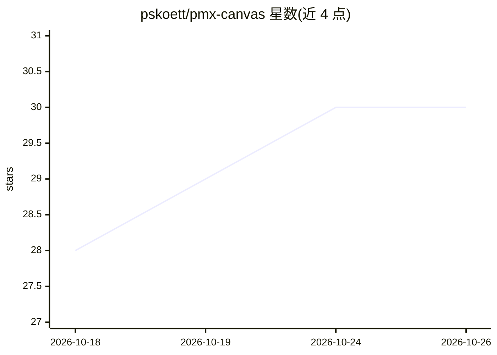

# pskoett/pmx-canvas

⭐ 30 · TypeScript · MIT · 推送 2026-10-24 · [GitHub](https://github.com/pskoett/pmx-canvas) · [官网](https://www.npmjs.com/package/pmx-canvas) · 个人维护

**人与 AI agent 共用的共享画板：收集证据、策展上下文**

本地运行的无限画板应用：用户将笔记、文件、网页、图片、图表、代码 diff 等卡片并置，通过置顶卡片策展上下文，链接结论与来源；agent 经 MCP 协议接入后在同一画板上增改材料，用户可查看 agent 已读内容。支持 Claude Code、Codex、GitHub Copilot、Amp 等客户端，提供 CLI、MCP、HTTP API 与 Bun SDK。板数据自动保存在项目目录的 .pmx-canvas/canvas.db，无内置多用户账户。

## 筛选速览

| 维度 | 判定 | 备注 |
|---|---|---|
| AI 角色 | `ai-ecosystem` | LLM/agent 周边工具 |
| 许可风险 | `permissive` | MIT |
| 部署形态 | `library` | 以包/库形式分发 |
| 模型依赖 | — | README 未给出锁定关系 |
| 硬件要求 | — | 无带数字的原话,不猜 |
| 安装摩擦 | `low` | 无编译、无系统依赖或容器化 |
| 成熟度 | — | 结构信号不足 |

## 能力要点

- 人与多个 agent 实时共用同一画板，经 MCP 协议连接
- 置顶卡片策展上下文、结论与来源链接、变更追踪
- 卡片可导出为自包含 HTML 或以导览形式演示
- 提供 CLI、MCP、HTTP API、Bun SDK 与 Agent Plugins 1.0 标准插件

## 适用场景

- 把分散在聊天与文件中的研究材料集中到一块板上供 agent 使用
- 跟踪 agent 读过什么、改了什么，把结果作为新材料放回画板
- 为编码 agent（Claude Code/Codex/Copilot）建立项目工作看板

## 场景标签

`Agent 记忆` `知识库管理` · 领域:Agent 开发

## 证据(README 行号)

> L93: PMX Canvas works with Claude Code, Codex, GitHub Copilot, Amp, and other agents
> L124: Without a plugin, add a server to your agent's MCP settings with command
> L161: PMX Canvas runs locally and has no built-in multi-user accounts. Connected

## 星数曲线

2026-10-18 28 → 2026-10-26 30（+2）

---
*卡片 v1 · prompt 1.4 · 生成 2026-10-26 · 置信度 high · 依据 README sha `d13c839e4aa4` · [字段定义](../../DATASET.md)*
