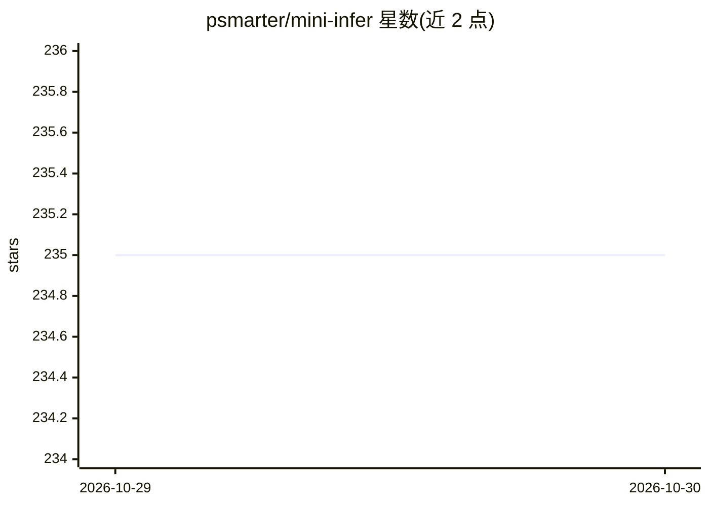

# psmarter/mini-infer

⭐ 235 · Python · MIT · 推送 2026-04-24 · [GitHub](https://github.com/psmarter/mini-infer) · [官网](https://smarter.xin/) · 个人维护 · 中文 README

**从零实现的 LLM 推理引擎，含分页 KV 缓存与 OpenAI 兼容服务**

用 PyTorch 从零实现的教学/实验取向 LLM 推理引擎：实现 True PagedAttention（flash_attn block_table）、Continuous Batching、Chunked Prefill、Prefix Caching、Speculative Decoding、CUDA Graph、Flash Decoding、Tensor Parallelism 与 PD 解耦，每项机制附独立 benchmark 与量化数据；核心 serving 路径提供 OpenAI 兼容 HTTP API 与 /healthz。支持 Qwen2.5/DeepSeek-V2，提供 dry-run 模式（无需模型权重）、Docker 与 CI。README 明确列出与 vLLM 的差异，自述为单机原型而非生产级系统，TP 在小模型下吞吐未提升仅验证正确性。

## 筛选速览

| 维度 | 判定 | 备注 |
|---|---|---|
| AI 角色 | `ai-ecosystem` | LLM/agent 周边工具 |
| 许可风险 | `permissive` | MIT |
| 部署形态 | `library` | 以包/库形式分发 |
| 模型依赖 | — | README 未给出锁定关系 |
| 硬件要求 | — | 无带数字的原话,不猜 |
| 安装摩擦 | `medium` | 含编译或系统依赖之一 |
| 成熟度 | `idea` | |

## 能力要点

- True PagedAttention + Continuous Batching 主 serving 路径，OpenAI 兼容 HTTP API
- Speculative Decoding / CUDA Graph / Flash Decoding / Tensor Parallelism 等独立 benchmark 实验
- --dry-run 无权重启动验证，/healthz 健康检查
- 提供 Docker、CI 与逐项复现命令的 benchmark 文档

## 适用场景

- 学习与研究 LLM 推理机制（分页注意力、连续批处理、投机解码等）的实现
- 在本机复现各推理机制的 benchmark 数据
- 以 OpenAI 兼容 API 起一个轻量实验性推理服务

## 场景标签

`推理引擎` · 领域:训练与推理

## 证据(README 行号)

> L3: **LLM inference engine built from scratch** — paged KV cache, continuous batching, chunked prefill, prefix caching, 
> L101: |**目标**|从零实现并测量关键推理机制|生产级：高吞吐、多模型、SLO 保障|

## 星数曲线

2026-10-29 235 → 2026-10-30 235（+0）

---
*卡片 v1 · prompt 1.4 · 生成 2026-10-28 · 置信度 high · 依据 README sha `7eb449116e39` · [字段定义](../../DATASET.md)*
