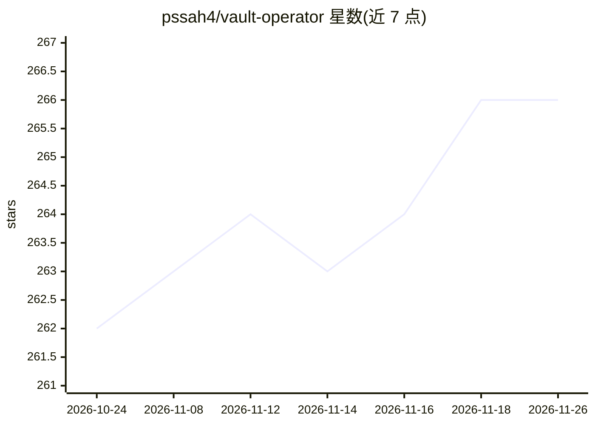

# pssah4/vault-operator

⭐ 266 · TypeScript · Apache-2.0 · 推送 2026-11-07 · [GitHub](https://github.com/pssah4/vault-operator) · [官网](https://pssah4.github.io/vault-operator/) · 个人维护 · 中文 README

**Obsidian 知识库内的智能体 AI 操作层插件**

运行在 Obsidian 中的开源插件，将 vault 变为 agent 工作环境：描述任务后由 agent 循环执行搜索、读取、写入并汇报，写操作需审批，每次变更通过 shadow git 检查点可一键撤销。功能包括行内 AI 聊天与快捷动作、多会话并行、PDF 摄取（块级溯源）、三层跨会话记忆、本地向量+全文+图扩展+重排的语义搜索、DOCX/XLSX/PPTX 生成、vault 健康检查、MCP 服务器暴露（供 ChatGPT/Claude Desktop 等客户端读取 vault），以及按类别的自动审批权限中心。本地优先、无遥测，支持云端模型或 Ollama/LM Studio 离线运行；需 Obsidian 1.8.7+，仅桌面端。

## 筛选速览

| 维度 | 判定 | 备注 |
|---|---|---|
| AI 角色 | `ai-native` | 本体是模型或模型工具 |
| 许可风险 | `permissive` | Apache-2.0 |
| 部署形态 | `library` | 以包/库形式分发 |
| 模型依赖 | local-ok | 支持本地模型 |
| 硬件要求 | — | 无带数字的原话,不猜 |
| 安装摩擦 | `low` | 无编译、无系统依赖或容器化 |
| 成熟度 | — | 结构信号不足 |

## 能力要点

- agent 循环执行任务：写操作需审批，shadow git 检查点一键撤销
- 块级溯源的 PDF/Markdown 摄取与本地语义搜索（向量+全文+图+重排）
- 三层跨会话记忆：会话摘要、持久事实、用户画像
- 作为 MCP 服务器供 ChatGPT、Claude Desktop、Perplexity 访问 vault

## 适用场景

- 在 Obsidian 中让 AI 代为整理、摄取和改写笔记
- 用语义搜索按含义查找知识库内容
- 把会议/论文笔记转成 Word、Excel 或 PPT 草稿
- 让 ChatGPT 等外部 AI 客户端读取同一份 vault 记忆

## 场景标签

`知识库管理` `语义搜索` `AI 助手` · 领域:对话与助手

## 证据(README 行号)

> L5: **Agentic AI operating layer for your vault.**
> L9: You describe a task, it plans, searches, reads, writes, and reports back. Every action is visible. Every write needs
> L47: A chatbot reads your prompt and answers. Vault Operator runs a loop: it picks an action, executes it against your v

## 星数曲线

2026-10-24 262 → 2026-11-26 266（+4）

---
*卡片 v1 · prompt 1.4 · 生成 2026-11-25 · 置信度 high · 依据 README sha `9f139d851aff` · [字段定义](../../DATASET.md)*
