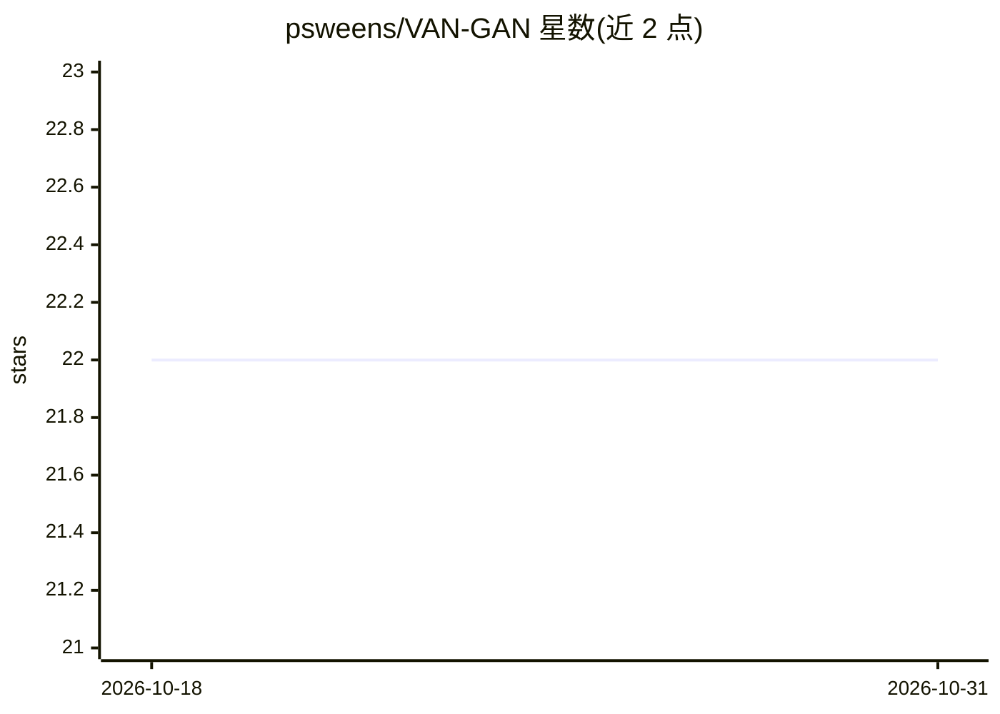

# psweens/VAN-GAN

⭐ 22 · Python · MIT · 推送 2026-01-07 · [GitHub](https://github.com/psweens/VAN-GAN) · 个人维护

**无监督 3D 血管网络分割的深度学习框架**

基于 CycleGAN 风格图像到图像翻译的深度学习框架，从 3D 光声生物图像中分割血管网络，无需成对训练数据或人工标注。采用 3D 深度残差 U-Net 生成器、拓扑与结构约束、滑动窗口推理处理高分辨率体数据。训练使用合成血管图像。要求 Python 3.9+、TensorFlow 2.10.1、CUDA 11.2.2 与 cuDNN 8.1.0.77，通过 git clone 源码安装。配套模拟光声图像与合成分割配对数据集可从剑桥大学仓库下载。

## 筛选速览

| 维度 | 判定 | 备注 |
|---|---|---|
| AI 角色 | `ai-native` | 本体是模型或模型工具 |
| 许可风险 | `permissive` | MIT |
| 部署形态 | `library` | 以包/库形式分发 |
| 模型依赖 | — | README 未给出锁定关系 |
| 硬件要求 | — | 无带数字的原话,不猜 |
| 安装摩擦 | `medium` | 含编译或系统依赖之一 |
| 成熟度 | — | 结构信号不足 |

## 能力要点

- 无需标注数据的全无监督血管分割
- 3D 深度残差 U-Net 与 CycleGAN 风格域翻译架构
- 合成训练图像替代人工标注
- 滑动窗口推理支持高分辨率 3D 体数据

## 适用场景

- 从 3D 光声图像中提取血管网络结构
- 缺乏标注数据时训练血管分割模型
- 用公开配对数据集验证无监督分割效果

## 场景标签

`目标检测` · 领域:感知与多模态

## 证据(README 行号)

> L3: **VAN-GAN** provides an accessible and efficient deep learning framework for the **segmentation of vascular networks
> L9: It adapts and extends the CycleGAN framework to translate between real photoacoustic images and synthetic vessel lab

## 星数曲线

2026-10-18 22 → 2026-10-31 22（+0）

---
*卡片 v1 · prompt 1.4 · 生成 2026-10-27 · 置信度 mid · 依据 README sha `a7aed6d8660a` · [字段定义](../../DATASET.md)*
