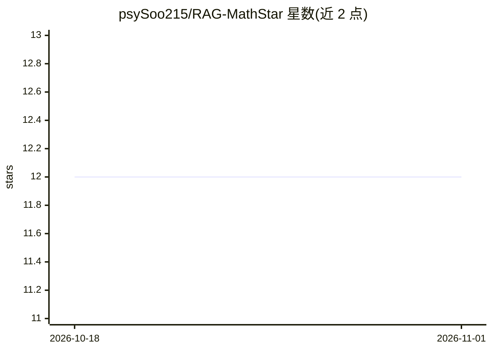

# psySoo215/RAG-MathStar

⭐ 12 · 推送 2026-07-09 · [GitHub](https://github.com/psySoo215/RAG-MathStar) · [官网](http://starvii.tpddns.cn:9001/info) · 个人维护 · 中文 README

**面向多学段数学问答的 RAG 智能解答系统与量化模型**

基于 Qwen2.5-3B-Instruct 进行数学领域 SFT 与 GRPO 强化学习训练的数学问答系统，结合 RAG 检索与 Agent 处理模块，支持小学/初中/高中多学段知识库、个性化知识库管理与私有文件上传。提供 Web 前端，支持对话问答、思维链展示与文本/语音多模态输入，可本地或在线双模式部署。原始模型面向服务器推理，社区提供 GGUF 量化版本（Q2_K 至 f16）用于本地与边缘设备运行。

## 筛选速览

| 维度 | 判定 | 备注 |
|---|---|---|
| AI 角色 | `ai-native` | 本体是模型或模型工具 |
| 许可风险 | `none` | — |
| 部署形态 | `None` |  |
| 模型依赖 | local-ok | 支持本地模型 |
| 硬件要求 | — | 无带数字的原话,不猜 |
| 安装摩擦 | `low` | 无编译、无系统依赖或容器化 |
| 成熟度 | — | 结构信号不足 |

## 能力要点

- Qwen2.5-3B-Instruct 基础上做数学 SFT 与 GRPO 强化学习
- RAG 框架集成 Agent 处理模块，多知识库检索
- 多学段知识库与私有文件上传管理
- GGUF 量化版本支持本地与轻量设备运行

## 适用场景

- 学生/教师进行数学问题讲解与答疑
- 教育机构搭建智能答疑与个性化学习平台
- 开发者在本地或边缘设备部署数学问答模型

## 场景标签

`RAG` `微调` `强化学习` · 领域:知识与检索

## 证据(README 行号)

> L3: 基于 RAG（检索增强生成）与大语言模型的算术与数学问题智能解答系统
> L27: - 采用 Qwen2.5-3B-Instruct 作为基础模型，针对数学推理领域进行高质量 SFT（监督微调）。

## 星数曲线

2026-10-18 12 → 2026-11-01 12（+0）

---
*卡片 v1 · prompt 1.4 · 生成 2026-11-01 · 置信度 high · 依据 README sha `6e023c996c79` · [字段定义](../../DATASET.md)*
