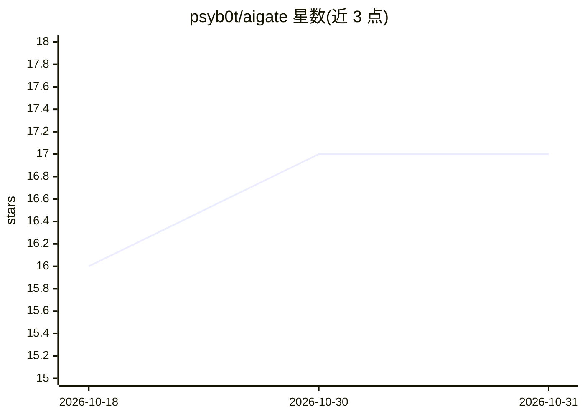

# psyb0t/aigate

⭐ 17 · Shell · WTFPL · 推送 2026-10-21 · [GitHub](https://github.com/psyb0t/aigate) · [官网](https://ciprian.51k.eu/aigate-your-own-ai-infrastructure/) · 个人维护

**自托管 AI 平台：推理/工具/浏览器/生成等能力统一为 OpenAI 兼容端点**

用一套 docker-compose 部署的自托管 AI 平台，将多云与本地模型推理、MCP 工具调用、隐身浏览器集群、图像生成、TTS、转写、对象存储、沙箱代码执行、Telegram/邮件网关、时间序列预测与音频/视频处理等能力聚合到 localhost:4000 的单一 OpenAI 兼容端点后，现有客户端指向即可使用。网关按优先级在多家 provider 间路由并在限流/失败时回退，本地 provider 跑在自有 CPU 或 NVIDIA GPU 上。所有组件均通过 .env 开关按需启用，附带 LibreChat Web UI。

## 筛选速览

| 维度 | 判定 | 备注 |
|---|---|---|
| AI 角色 | `ai-ecosystem` | LLM/agent 周边工具 |
| 许可风险 | `viral` | WTFPL |
| 部署形态 | `self-host` | docker 或自建部署 |
| 模型依赖 | local-ok | 支持本地模型 |
| 硬件要求 | — | 无带数字的原话,不猜 |
| 安装摩擦 | `low` | 无编译、无系统依赖或容器化 |
| 成熟度 | — | 结构信号不足 |

## 能力要点

- 单一 OpenAI 兼容端点聚合多云与本地 provider，按优先级路由并自动回退
- 本地 provider（Ollama、vllm-wrap、llama.cpp、stable-diffusion.cpp 等）运行于自有 CPU/NVIDIA GPU，无网络调用与用量费用
- MCP 工具覆盖浏览器自动化、沙箱代码执行（nsjail 隔离、40+ 语言）、对象存储、音频/视频处理
- 一切能力 opt-in，`.env` 开关控制，`make run-bg` 完成安装

## 适用场景

- 把多种 AI 能力统一到一个自托管网关端点供现有客户端调用
- 让带函数调用的模型自主编排浏览器、代码执行、搜索等 MCP 工具
- 在自有硬件上无 API 成本地跑 LLM、TTS、转写与图像生成

## 场景标签

`模型网关` `浏览器自动化` · 领域:Agent 开发

## 证据(README 行号)

> L9: Everything an AI-powered workflow needs, inference, tool use, browser automation, image generation, speech synthesis
> L13: Models across multiple providers. Five providers offer free tiers (Groq, OpenRouter, HuggingFace, Mistral, Cohere).
> L17: MCP tools across multiple servers. Any model with function calling can invoke them autonomously — the model orchest

## 星数曲线

2026-10-18 16 → 2026-10-31 17（+1）

---
*卡片 v1 · prompt 1.4 · 生成 2026-10-30 · 置信度 high · 依据 README sha `709f352747d2` · [字段定义](../../DATASET.md)*
