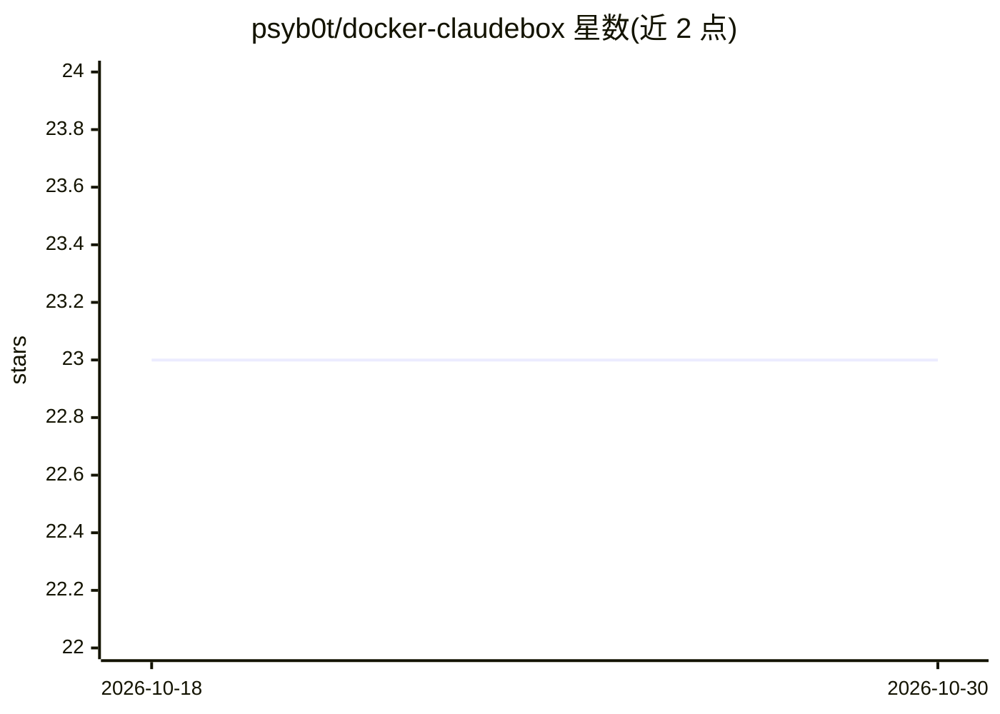

# psyb0t/docker-claudebox

⭐ 23 · Shell · WTFPL · 推送 2026-10-22 · [GitHub](https://github.com/psyb0t/docker-claudebox) · [官网](https://ciprian.51k.eu/docker-claude-code-your-ai-dev-agent-containerized-and-unhinged/) · 个人维护

**在 Docker 中运行 Claude Code 的多接口封装器，支持终端/HTTP/MCP/Telegram/定时**

构建于共享 aicodebox 运行时之上的 Claude Code Docker 封装：拉取镜像并安装 claudebox 命令，挂载当前目录、持久化 Claude 状态与 SSH 密钥、默认恢复上次会话。提供交互终端、单次程序化调用、HTTP /run 与 OpenAI 兼容端点、MCP 服务器、Telegram 机器人及 cron 定时任务六种接口。镜像分 minimal 与 full（含 Go/Python/Node/C++ 等工具链）两种变体，Claude Code CLI 在容器首次启动时从 npm 安装。README 明确声明标准封装不是安全沙箱：使用主机网络、挂载 Docker socket、密码免 sudo 且绕过权限提示，仅适用于可信工作负载。

## 筛选速览

| 维度 | 判定 | 备注 |
|---|---|---|
| AI 角色 | `ai-ecosystem` | LLM/agent 周边工具 |
| 许可风险 | `viral` | WTFPL |
| 部署形态 | `self-host` | docker 或自建部署 |
| 模型依赖 | — | README 未给出锁定关系 |
| 硬件要求 | — | 无带数字的原话,不猜 |
| 安装摩擦 | `low` | 无编译、无系统依赖或容器化 |
| 成熟度 | — | 结构信号不足 |

## 能力要点

- 六种接口：交互终端、程序化模式、HTTP /run 与 OpenAI 兼容端点、MCP、Telegram、cron
- minimal 与 full 两种镜像变体，full 含完整开发工具链
- 持久化 Claude 状态与 SSH 密钥，默认恢复工作区上次会话
- 支持 GitHub Action 一次性任务与兄弟封装器（codexbox/pibox）嵌套启动

## 适用场景

- 在隔离的 Docker 环境中运行 Claude Code 处理本地项目
- 通过 HTTP API 或 OpenAI 兼容端点把 Claude Code 接入其他程序
- 用 Telegram 远程操作工作区或用 cron 定时跑任务
- 在 CI 的 GitHub Action 中以只读上下文执行一次性任务

## 场景标签

`编码 Agent` · 领域:编码与开发

## 证据(README 行号)

> L8: Run Claude Code in Docker, from an interactive terminal, a script, an HTTP client, MCP, Telegram, or a cron schedule
> L72: |HTTP `/run`, files, async polling, and OpenAI-compatible chat|API mode|
> L73: |Streamable HTTP tools for other agents|MCP mode|

## 星数曲线

2026-10-18 23 → 2026-10-30 23（+0）

---
*卡片 v1 · prompt 1.4 · 生成 2026-10-27 · 置信度 high · 依据 README sha `a0e800e1fd88` · [字段定义](../../DATASET.md)*
