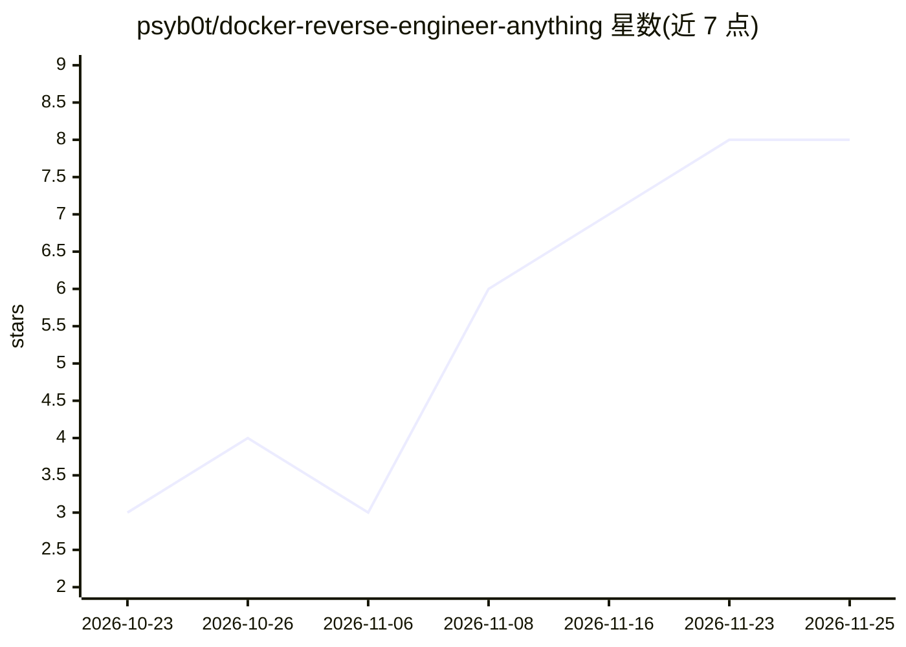

# psyb0t/docker-reverse-engineer-anything

⭐ 8 · TypeScript · WTFPL · 推送 2026-11-10 · [GitHub](https://github.com/psyb0t/docker-reverse-engineer-anything) · 个人维护

**把 APK 逆向工具打包成 Docker，供 AI agent 通过 MCP 调用**

将 morluto 的 REA（MCP server + CLI）打包为 Docker 镜像：内置 rea-agents 6.4.0（170 个 MCP 工具）、OpenJDK 21、JADX、Apktool 3.0.3、adb 与 Node.js 24，支持 amd64/arm64。通过 token 鉴权的 Streamable HTTP MCP 端点（默认 bridge 模式）暴露，也可运行原生 stdio MCP 或直接调用 REA CLI。支持反编译 APK、追踪引用、读取资源、经 adb 操作设备，以及 Electron、.NET、Go、Rust、WASM、SQLite 等静态分析；Ghidra 原生反编译为按需下载的可选项（amd64，校验 SHA-256）。README 强调容器即安全边界，工具不做权限检查，仅用于自有或获授权的软件。

## 筛选速览

| 维度 | 判定 | 备注 |
|---|---|---|
| AI 角色 | `ai-ecosystem` | LLM/agent 周边工具 |
| 许可风险 | `viral` | WTFPL |
| 部署形态 | `self-host` | docker 或自建部署 |
| 模型依赖 | — | README 未给出锁定关系 |
| 硬件要求 | — | 无带数字的原话,不猜 |
| 安装摩擦 | `low` | 无编译、无系统依赖或容器化 |
| 成熟度 | — | 结构信号不足 |

## 能力要点

- 镜像内置 170 个 MCP 工具与 OpenJDK 21、JADX、Apktool、adb，APK 开箱即用
- 三种运行模式：HTTP bridge（token 鉴权）、stdio MCP、REA CLI
- Ghidra 按需下载（约 900 MB，固定 SHA-256 校验），另支持自带 IDA/JEB
- 提供 Claude Code/Codex/OpenClaw 的技能与插件集成

## 适用场景

- 让 AI agent 反编译并分析无源码的 Android APK
- 通过 MCP 端点让 agent 读取资源、追踪引用、操作 adb 设备
- 对 Electron、.NET、Go、Rust 二进制做静态检查

## 场景标签

`网络安全` · 领域:学习与行业

## 证据(README 行号)

> L8: REA (Reverse Engineer Anything) in a Docker image, with everything it needs to tear apart Android APKs already insid
> L10: REA is morluto's MCP server and CLI that lets an AI agent inspect software it has no source for: decompile APKs, tr
> L41: |`bridge`|Default. Streamable HTTP MCP on port 8080 at `/mcp`, bearer token required.|

## 星数曲线

2026-10-23 3 → 2026-11-25 8（+5）

---
*卡片 v1 · prompt 1.4 · 生成 2026-11-20 · 置信度 high · 依据 README sha `bd228d1b23d2` · [字段定义](../../DATASET.md)*
