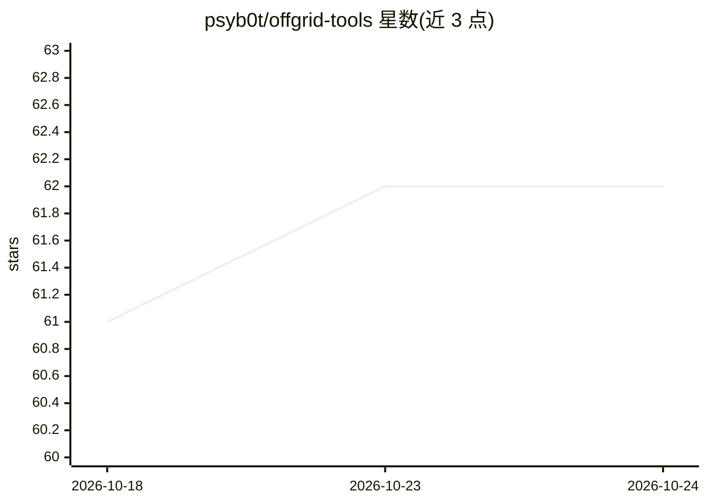

# psyb0t/offgrid-tools

⭐ 62 · Shell · WTFPL · 推送 2026-10-19 · [GitHub](https://github.com/psyb0t/offgrid-tools) · [官网](https://ciprian.51k.eu/offgrid-tools-building-your-own-fucking-internet-an-offgrid-survival-stack/) · 个人维护

**离线自足环境套件：本地 AI 聊天、维基归档、IRC、音频流与开发工具**

Docker Compose 编排的离线服务集合，覆盖本地 AI 聊天（Ollama + Open WebUI、带 RAG 的多人聊天室、llama.cpp GGUF 运行器、Strata 离线推理）、Kiwix ZIM 内容归档、InspIRCd/TheLounge IRC、Icecast 音频广播、HTTP 文件服务器，以及 APK/DEB/ISO/预装 Ubuntu VM 等离线物资。设计目标为零互联网依赖：联网时下载镜像、模型与内容，断网后本地运行。仅在 Ubuntu 上测试；模型需提前下载，仅 clone 仓库不构成离线安装。

## 筛选速览

| 维度 | 判定 | 备注 |
|---|---|---|
| AI 角色 | `ai-ecosystem` | LLM/agent 周边工具 |
| 许可风险 | `viral` | WTFPL |
| 部署形态 | `self-host` | docker 或自建部署 |
| 模型依赖 | local-ok | 支持本地模型 |
| 硬件要求 | `gpu-8g` | |
| 安装摩擦 | `low` | 无编译、无系统依赖或容器化 |
| 成熟度 | — | 结构信号不足 |

## 能力要点

- Ollama + Open WebUI 本地聊天与带 RAG 的共享聊天室
- llama.cpp 启动脚本运行 GGUF 模型（量化选择、GPU 层、视觉投影配置）
- Strata 提供 OpenAI 兼容 API 的离线推理，支持 256K 上下文
- save/load 脚本将全部容器镜像导出为带 SHA256 校验的离线归档

## 适用场景

- 断网前预下载镜像、模型与内容，搭建零依赖本地环境
- 无网络地区离线查阅维基百科与编程文档（Kiwix ZIM）
- 本地网络内 IRC 通信、音频广播与文件分发
- 应急/灾害场景保留通信、知识与开发能力

## 场景标签

`聊天机器人` `推理引擎` · 领域:对话与助手

## 证据(README 行号)

> L9: Docker Compose setup for when the internet dies and you still need to get shit done.
> L46: ### Ollama (port 11434)
> L76: Run GGUF models with llama.cpp Docker containers.

## 星数曲线

2026-10-18 61 → 2026-10-24 62（+1）

---
*卡片 v1 · prompt 1.4 · 生成 2026-10-24 · 置信度 high · 依据 README sha `e978a033ab40` · [字段定义](../../DATASET.md)*
