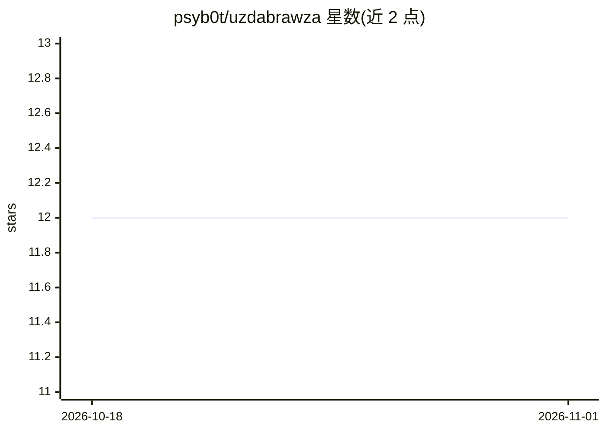

# psyb0t/uzdabrawza

⭐ 12 · Python · WTFPL · 推送 2026-10-19 · [GitHub](https://github.com/psyb0t/uzdabrawza) · 个人维护

**命令行 LLM 浏览器自动化工具：用自然语言任务驱动浏览器**

基于 browser-use 库构建的命令行工具，以自然语言任务驱动浏览器操作。支持 9 个 AI 提供商（默认 Ollama 本地模型），提供 AI 视觉开关与精度调节、基于 patchright 的反检测隐身模式、对每次 LLM 调用的监控日志，每次运行生成 GIF 录屏与 JSON 历史文件。支持 headless 模式、自定义浏览器路径、CDP 连接已有浏览器，以及 Docker 容器优化参数。README 语言粗俗，但功能以浏览器自动化任务为核心。

## 筛选速览

| 维度 | 判定 | 备注 |
|---|---|---|
| AI 角色 | `ai-native` | 本体是模型或模型工具 |
| 许可风险 | `viral` | WTFPL |
| 部署形态 | `library` | 以包/库形式分发 |
| 模型依赖 | local-ok | 支持本地模型 |
| 硬件要求 | — | 无带数字的原话,不猜 |
| 安装摩擦 | `low` | 无编译、无系统依赖或容器化 |
| 成熟度 | — | 结构信号不足 |

## 能力要点

- 9 个 AI 提供商支持，默认使用 Ollama 本地模型
- 基于 patchright 的隐身反检测模式（自动检测启用）
- 每次运行输出 GIF 录屏与完整 JSON 历史文件
- LLM 调用监控：记录提供商、模型、消息数与输出格式

## 适用场景

- 用自然语言指派浏览器完成网页任务
- 以本地 Ollama 模型免 API 费用运行浏览器 agent
- 在 Docker 容器中运行无头浏览器自动化

## 场景标签

`浏览器自动化` · 领域:效率与自动化

## 证据(README 行号)

> L11: uzdabrawza is the most irreverent, crude, and effective neural brainfuck automation script you'll ever encounter. T
> L13: - **9 fucking neural overlords** - OpenAI, Anthropic, Google, Ollama, Azure, DeepSeek, Groq, OpenRouter, AWS Bedroc
> L236: Built on top of the excellent browser-use library with these additional features:

## 星数曲线

2026-10-18 12 → 2026-11-01 12（+0）

---
*卡片 v1 · prompt 1.4 · 生成 2026-11-01 · 置信度 mid · 依据 README sha `2daf54476d6e` · [字段定义](../../DATASET.md)*
