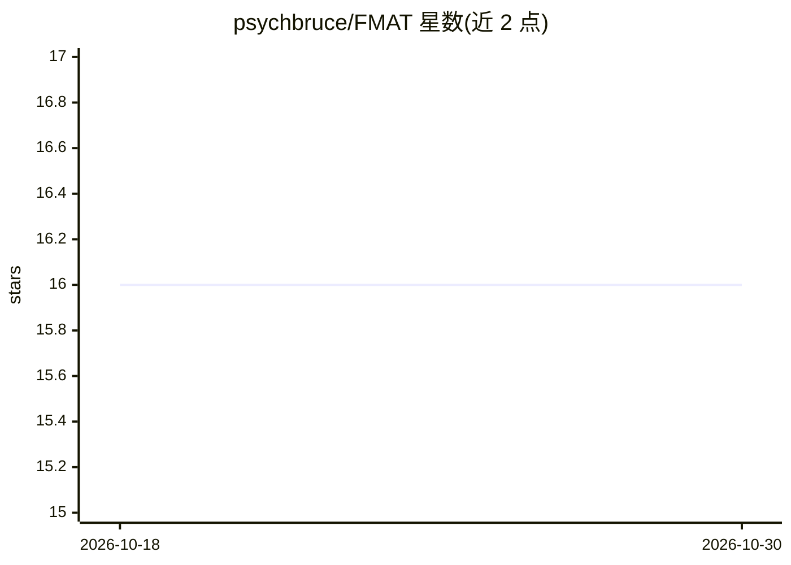

# psychbruce/FMAT

⭐ 16 · R · GPL-3.0 · 推送 2026-03-07 · [GitHub](https://github.com/psychbruce/FMAT) · [官网](https://psychbruce.github.io/FMAT/) · 个人维护 · 中文 README

**基于 BERT 掩码填空测量自然语言中概念联系的社会计算方法**

R 语言包形式的掩码填空联系测验（FMAT）：通过 BERT 模型对查询语句做掩码填空概率估计，将态度、偏见、刻板印象、社会规范、文化价值观等测量为命题式语义表征。流程为下载 BERT 模型（Hugging Face）、设计查询（FMAT_query）、运行估计（FMAT_run）。需配套 Python 环境与 transformers/huggingface-hub/torch 三个包，默认 CPU 运行、可选用 NVIDIA GPU 加速；已验证 12 个英文模型及 32 英文/32 中文模型列表。

## 筛选速览

| 维度 | 判定 | 备注 |
|---|---|---|
| AI 角色 | `ai-native` | 本体是模型或模型工具 |
| 许可风险 | `viral` | GPL-3.0 |
| 部署形态 | `desktop` | 安装包/桌面程序 |
| 模型依赖 | — | README 未给出锁定关系 |
| 硬件要求 | — | 无带数字的原话,不猜 |
| 安装摩擦 | `medium` | 含编译或系统依赖之一 |
| 成熟度 | — | 结构信号不足 |

## 能力要点

- BERT 掩码填空概率估计测量概念联系（JPSP 2024 方法学论文）
- 覆盖 12 个经典英文模型与 32 英文/32 中文模型列表
- 自动适配不同 mask token 与特殊前缀字符（[MASK]/<mask>/Ġ/▁）
- 默认 CPU 运行，可选 NVIDIA GPU（CUDA）加速

## 适用场景

- 社会心理学研究中测量语言中的刻板印象与偏见
- 跨文化比较自然语言中的概念联系
- 利用预训练 BERT 模型做命题式语义测量

## 场景标签

`科研工具` · 领域:学习与行业

## 证据(README 行号)

> L5: The *Fill-Mask Association Test* (FMAT) is an integrative, probability-based social computing method using [BERT Mod
> L37: Besides the R package `FMAT`, you also need to have a Python environment and install three Python packages (`transf
> L131: Use `FMAT_run()` to get raw data (probability estimates) for further analysis.

## 星数曲线

2026-10-18 16 → 2026-10-30 16（+0）

---
*卡片 v1 · prompt 1.4 · 生成 2026-10-30 · 置信度 mid · 依据 README sha `0cf285c7e149` · [字段定义](../../DATASET.md)*
