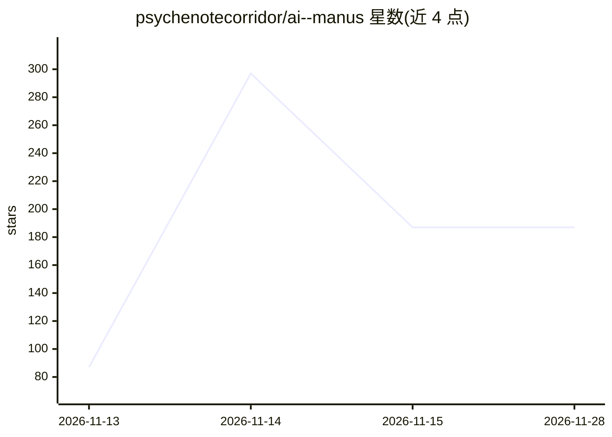

# psychenotecorridor/ai--manus

⭐ 187 · Apache-2.0 · 推送 2026-11-15 · [GitHub](https://github.com/psychenotecorridor/ai--manus) · 个人维护

**面向个人用户的自主 AI Agent：代为执行代码与浏览器操作**

Manus 是一个自主 AI Agent 系统，宣称可在沙箱环境中运行多种工具与操作：代替用户编写并执行脚本、控制浏览器（导航网页、填写表单、抓取信息）、执行多步骤日常任务，定位为家用、学习与轻量办公的个人助理，面向不具备开发背景的用户。README 描述了代码执行与浏览器控制可在一个流程内衔接，并在会话间保持任务模式。需要说明：README 为营销式介绍，未给出任何安装命令、代码仓库结构、技术架构或模型接入方式的具体信息，仅有下载入口与促销码，可验证的技术细节有限。

## 筛选速览

| 维度 | 判定 | 备注 |
|---|---|---|
| AI 角色 | `ai-native` | 本体是模型或模型工具 |
| 许可风险 | `permissive` | Apache-2.0 |
| 部署形态 | `None` |  |
| 模型依赖 | — | README 未给出锁定关系 |
| 硬件要求 | — | 无带数字的原话,不猜 |
| 安装摩擦 | `low` | 无编译、无系统依赖或容器化 |
| 成熟度 | — | 结构信号不足 |

## 能力要点

- 自主执行代码：代理自行编写并运行脚本完成任务
- 浏览器控制：代理可导航网页、填写表单、收集信息
- 代码与浏览器操作可在同一多步骤任务流程中衔接
- 支持在沙箱环境中运行各种工具与操作（仓库描述）

## 适用场景

- 让 AI 代为执行重复性的小脚本与网页查资料任务
- 学习与研究中整理笔记、收集参考资料
- 轻量办公中汇总多个网页信息并准备小结

## 场景标签

`AI 助手` `编码 Agent` `浏览器自动化` · 领域:效率与自动化

## 证据(README 行号)

> L10: - **Autonomous Code Execution:** Manus AI agent runs code on its own to complete tasks, so you can focus on decisio
> L18: Manus is an autonomous AI agent designed to run code and control a browser on your behalf. Instead of acting like a
> L41: |**Memory (RAM)**|4 GB|8 GB or more for heavy Manus autonomous tasks|

## 星数曲线

2026-11-13 87 → 2026-11-28 187（+100）

---
*卡片 v1 · prompt 1.4 · 生成 2026-11-17 · 置信度 mid · 依据 README sha `0f78ee3a5dd2` · [字段定义](../../DATASET.md)*
