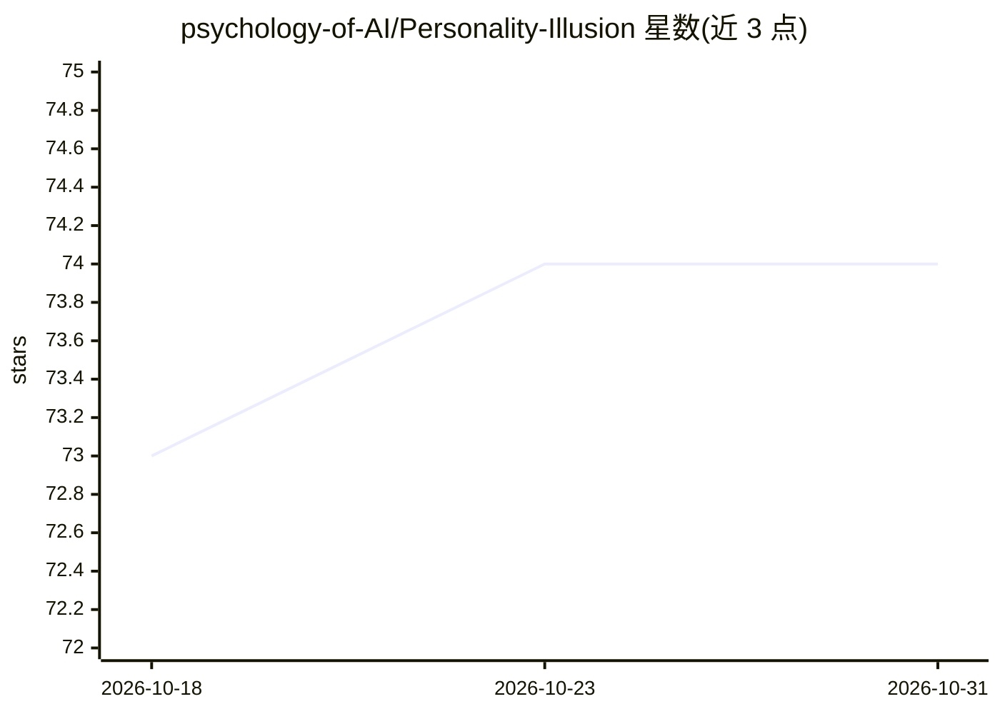

# psychology-of-AI/Personality-Illusion

⭐ 74 · Jupyter Notebook · MIT · 推送 2026-06-23 · [GitHub](https://github.com/psychology-of-AI/Personality-Illusion) · [官网](https://psychology-of-ai.github.io/) · 组织维护

**论文官方代码库：LLM 自我报告与行为的人格一致性研究**

ICML 2026 论文 'The Personality Illusion' 的官方代码仓库，研究 LLM 在自我报告问卷与实际行为任务之间的人格特质分离现象。仓库以 MIT 许可开源全部代码与实验结果数据：data 目录含 RQ1-RQ3 结果数据，self-reports 目录提供 BFI、SRQ 问卷测试代码，behavioral_tasks 目录提供风险偏好、谄媚性等行为任务测试代码。欢迎通过 PR 贡献新问卷、行为任务或更多 LLM。

## 筛选速览

| 维度 | 判定 | 备注 |
|---|---|---|
| AI 角色 | `ai-knowledge` | 知识聚合/清单类 |
| 许可风险 | `permissive` | MIT |
| 部署形态 | `None` |  |
| 模型依赖 | — | README 未给出锁定关系 |
| 硬件要求 | — | 无带数字的原话,不猜 |
| 安装摩擦 | `low` | 无编译、无系统依赖或容器化 |
| 成熟度 | — | 结构信号不足 |

## 能力要点

- 包含 RQ1-RQ3 全部实验结果数据
- BFI、SRQ 自我报告问卷测试代码
- 风险偏好、谄媚性等行为任务测试代码
- MIT 许可开源，接受社区贡献新增问卷/任务/模型

## 适用场景

- 复现论文中 LLM 人格自我报告与行为的对比实验
- 基于提供的问卷与行为任务框架扩展测试其他 LLM
- 下载实验结果数据进行二次分析

## 场景标签

`模型评测` `科研工具` · 领域:评测与运维

## 证据(README 行号)

> L11: This official repository holds code for the paper "**The Personality Illusion: Revealing Dissociation Between Self-
> L21: * The `data` folder contains all experiment result data we have for RQ1, RQ2, RQ3 in our paper. For a detailed walk

## 星数曲线

2026-10-18 73 → 2026-10-31 74（+1）

---
*卡片 v1 · prompt 1.4 · 生成 2026-10-24 · 置信度 high · 依据 README sha `134af90e8d5a` · [字段定义](../../DATASET.md)*
