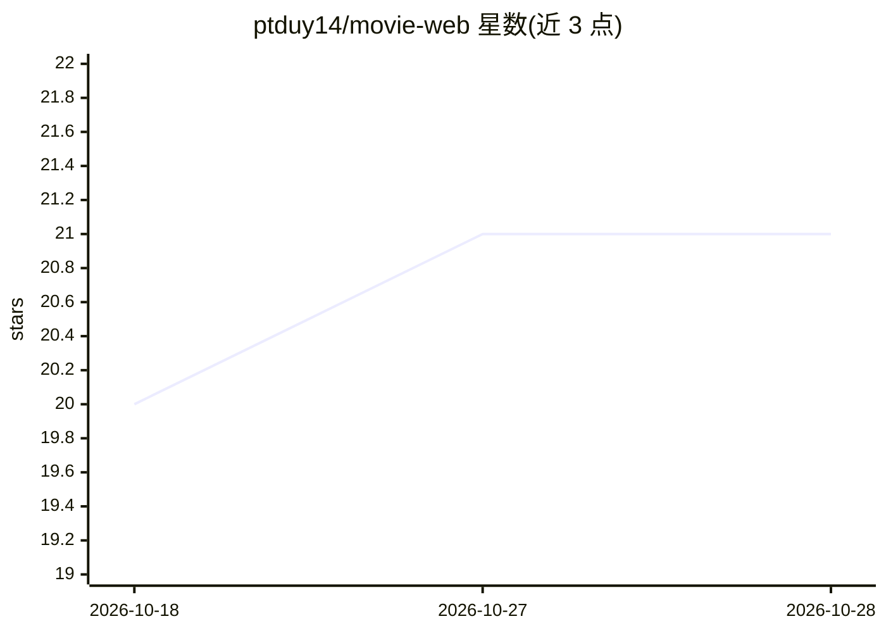

# ptduy14/movie-web

⭐ 21 · TypeScript · MIT · 推送 2026-10-28 · [GitHub](https://github.com/ptduy14/movie-web) · [官网](https://movie-web-seven-beta.vercel.app) · 个人维护

**Next.js 影视流媒体站点：AI 批量翻译补全多语言简介**

基于 Next.js 14 App Router 的电影流媒体 Web 应用，提供 Netflix 风格浏览、Firebase 邮箱认证、hls.js 播放与 VidSrc 备用源、跨设备观看进度同步、收藏夹与评论通知等社区功能。AI 部分为元数据翻译管线：通过 Groq API 调用 Llama 3.3 70B，在 Vercel Cron 定时任务中批量翻译影片标题与简介，Groq key 为可选项。部署依赖自备 Firebase 项目、TMDB token 与影片内容 API。

## 筛选速览

| 维度 | 判定 | 备注 |
|---|---|---|
| AI 角色 | `ai-enhanced` | 去掉 AI 部分产品仍成立 |
| 许可风险 | `permissive` | MIT |
| 部署形态 | `None` |  |
| 模型依赖 | locked-api |  |
| 硬件要求 | — | 无带数字的原话,不猜 |
| 安装摩擦 | `low` | 无编译、无系统依赖或容器化 |
| 成熟度 | — | 结构信号不足 |

## 能力要点

- Groq + Llama 3.3 70B 定时批量翻译影片元数据
- Firebase 认证与 Firestore 驱动的进度同步、收藏、评论
- hls.js 自有播放器，多服务器回退与 VidSrc 备用源
- next-intl 多语言路由与本地化 UI

## 适用场景

- 搭建带用户系统和个人收藏的电影流媒体站点
- 让站点元数据自动翻译为多语言而无需人工维护
- 多设备同步观影进度与社区评论互动

## 场景标签

 · 领域:Web 应用/影视流媒体

## 证据(README 行号)

> L27: **MovieX** is a full-featured, production-ready movie streaming web app built with **Next.js 14 (App Router)**. It 
> L32: - 🤖 **AI-driven internationalization** — uses the **Groq LLM API** (Llama 3.3 70B) inside a Vercel Cron job to batc
> L67: - **Automated batch translation** of new movie metadata via **Groq + Llama 3.3 70B**

## 星数曲线

2026-10-18 20 → 2026-10-28 21（+1）

---
*卡片 v1 · prompt 1.4 · 生成 2026-10-28 · 置信度 high · 依据 README sha `b4f978d76e18` · [字段定义](../../DATASET.md)*
