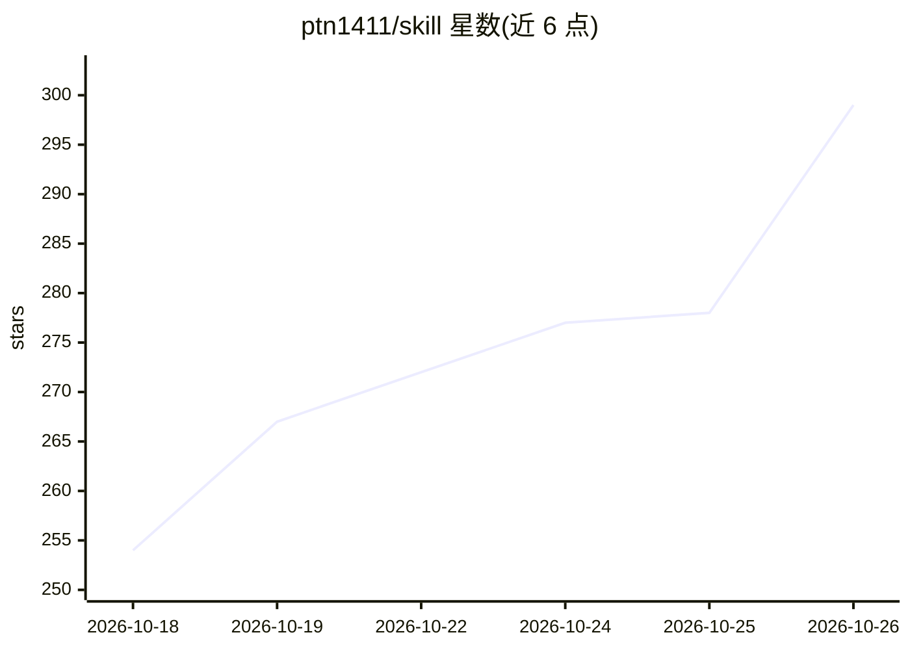

# ptn1411/skill

⭐ 299 · Python · 推送 2026-09-22 · [GitHub](https://github.com/ptn1411/skill) · [官网](https://ptn1411.github.io/skill/skill_playbook.html) · 个人维护

**面向 AI agent 的授权安全审计技能集与配套 Python CLI**

软件制品授权审计工具集：以 SKILL.md 格式提供 AI agent（Gemini CLI、Claude Code、Antigravity）可用的技能，配套可独立运行的 Python CLI。能力覆盖制品指纹与结构恢复、Web/网络侦察、SBOM 与供应链审计、Docker/Kubernetes/Terraform/云配置检查、Windows 日志威胁狩猎、CVE/Exploit-DB 情报查询与结构化报告生成。限制：仅可用于自有或获授权目标；外部工具（Node.js、JADX、Nmap 等）按需安装。

## 筛选速览

| 维度 | 判定 | 备注 |
|---|---|---|
| AI 角色 | `ai-ecosystem` | LLM/agent 周边工具 |
| 许可风险 | `none` | — |
| 部署形态 | `desktop` | 安装包/桌面程序 |
| 模型依赖 | locked-api |  |
| 硬件要求 | — | 无带数字的原话,不猜 |
| 安装摩擦 | `low` | 无编译、无系统依赖或容器化 |
| 成熟度 | — | 结构信号不足 |

## 能力要点

- SKILL.md 技能可同步至 Gemini CLI / Claude Code / Antigravity 全局配置
- 独立 Python CLI：全链路评估、漏洞情报查询、SBOM/云配置审计、二进制识别
- MASTER_POLICY.md 界定授权边界，查询 CVE/EDB 不运行 exploit
- 提供技能契约校验与单元测试（unittest）

## 适用场景

- 对我拥有或获授权的系统做安全审计与修复规划
- 给 Claude Code / Gemini CLI 等 agent 装载安全审计技能
- 生成 SBOM、检查 Docker/K8s/Terraform 配置与供应链风险

## 场景标签

`网络安全` · 领域:学习与行业

## 证据(README 行号)

> L3: Bộ công cụ và tập hợp skill hỗ trợ phân tích phần mềm, khôi phục cấu trúc nguồn ở mức cần thiết, rà soát bảo mật, ki
> L5: Dự án cung cấp cả hướng dẫn cho AI agent lẫn các CLI Python có thể chạy độc lập. Mọi workflow đều ưu tiên thu thập b
> L39: ### 2. Cài đặt / Đồng bộ Skill vào AI Agent (Gemini CLI, Claude Code, Antigravity)

## 星数曲线

2026-10-18 254 → 2026-10-26 299（+45）

---
*卡片 v1 · prompt 1.4 · 生成 2026-10-22 · 置信度 mid · 依据 README sha `3d18c0c1f7a3` · [字段定义](../../DATASET.md)*
