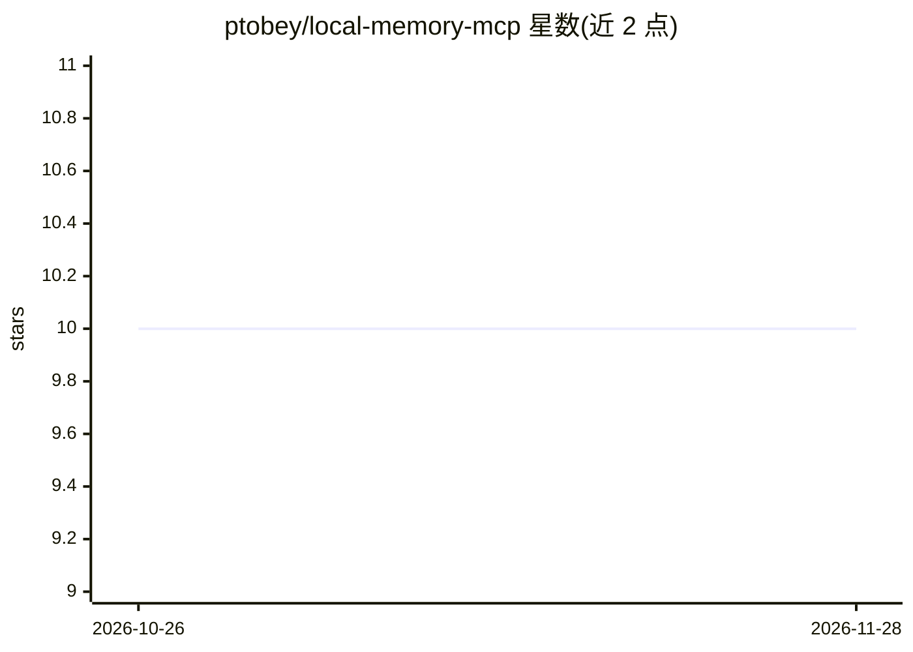

# ptobey/local-memory-mcp

⭐ 10 · Python · MIT · 推送 2026-07-11 · [GitHub](https://github.com/ptobey/local-memory-mcp) · 个人维护

**为 Claude/ChatGPT 等助手提供本地持久记忆的 MCP 服务器**

local-memory-mcp 是一个本地 MCP 服务器，通过 ChromaDB 向量检索为 MCP 兼容助手提供跨会话持久记忆：store/update 写入记忆并做冲突校验，search 采用两阶段检索（bi-encoder 召回 + 本地 cross-encoder 重排 + 自适应结果数）。支持版本化更新、软删除、来源标记与备份恢复，数据保存在本地文件，Docker 默认仅监听 127.0.0.1。提供 Claude Desktop 与 ChatGPT 接入文档。

## 筛选速览

| 维度 | 判定 | 备注 |
|---|---|---|
| AI 角色 | `ai-ecosystem` | LLM/agent 周边工具 |
| 许可风险 | `permissive` | MIT |
| 部署形态 | `self-host` | docker 或自建部署 |
| 模型依赖 | — | README 未给出锁定关系 |
| 硬件要求 | — | 无带数字的原话,不猜 |
| 安装摩擦 | `low` | 无编译、无系统依赖或容器化 |
| 成熟度 | — | 结构信号不足 |

## 能力要点

- 两阶段检索：bi-encoder 召回 + cross-encoder 重排，含自适应结果数与降级回退
- MCP 工具集：store/search/update/delete/备份恢复/冲突解决等
- 版本化更新与 supersedes 链，软删除默认保留历史
- 可选 none/bearer/oauth 认证，支持 stdio/SSE/streamable-HTTP 传输

## 适用场景

- 让 Claude/ChatGPT 记住我的偏好和项目背景，跨会话复用
- 本地自托管 RAG 记忆，不上传数据到云端
- 新会话启动时检索历史记忆生成简报

## 场景标签

`Agent 记忆` · 领域:Agent 开发

## 证据(README 行号)

> L7: `local-memory-mcp` gives Claude, ChatGPT, and other MCP-compatible assistants a persistent memory layer powered by l
> L19: local-memory-mcp is a local MCP server that lets your AI assistant:
> L78: - Stdio, SSE, and streamable-HTTP (`/mcp`) transports

## 星数曲线

2026-10-26 10 → 2026-11-28 10（+0）

---
*卡片 v1 · prompt 1.4 · 生成 2026-11-19 · 置信度 high · 依据 README sha `b8c6d26bc895` · [字段定义](../../DATASET.md)*
