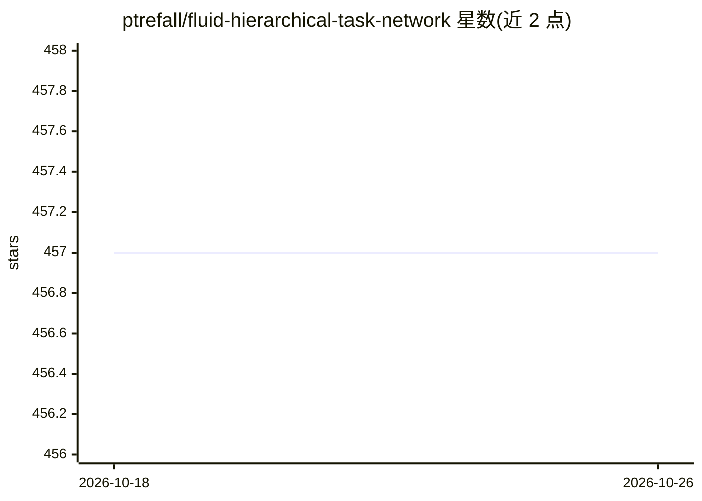

# ptrefall/fluid-hierarchical-task-network

⭐ 457 · C# · MIT · 推送 2026-03-18 · [GitHub](https://github.com/ptrefall/fluid-hierarchical-task-network) · 个人维护

**C# 的 HTN 规划器库：为游戏 AI 生成任务执行计划**

基于 Builder 模式的 C# 分层任务网络（HTN）规划库，实现全序前向分解规划（Troy Humphreys 在 GameAIPro 文章中描述的方法）。提供 Domain Builder 以代码方式定义 HTN 域，支持部分规划（Pause Plan）、子域拼接、运行时域槽位、仅计划失败/完成或世界状态变化时重规划、分解日志等功能；内部通过 Factory 接口管理对象创建以支持内存池化。面向使用 C#/Unity 的游戏开发者，附 Unity Package Module 定义与 159 个单元测试。

## 筛选速览

| 维度 | 判定 | 备注 |
|---|---|---|
| AI 角色 | `ai-native` | 本体是模型或模型工具 |
| 许可风险 | `permissive` | MIT |
| 部署形态 | `None` |  |
| 模型依赖 | — | README 未给出锁定关系 |
| 硬件要求 | — | 无带数字的原话,不猜 |
| 安装摩擦 | `low` | 无编译、无系统依赖或容器化 |
| 成熟度 | — | 结构信号不足 |

## 能力要点

- 全序前向分解 HTN 规划器，附 Domain Builder
- 支持部分规划、子域拼接与运行时域槽位
- Factory 接口支持自定义内存管理/对象池
- 附 Unity Package Module 定义与 159 个单元测试

## 适用场景

- 游戏 AI 角色的行为规划与计划生成
- 通过子域拼接与槽位复用组织大型 HTN 域
- 与 Smart Objects 结合在运行时扩展 agent 行为

## 场景标签

`Agent 框架` · 领域:Agent 开发

## 证据(README 行号)

> L12: * Fluid HTN is a total-order forward decomposition planner, as described by Troy Humphreys in his GameAIPro article
> L22: * Comes with Unity Package Module definitions for seamless integration into Unity projects.

## 星数曲线

2026-10-18 457 → 2026-10-26 457（+0）

---
*卡片 v1 · prompt 1.4 · 生成 2026-10-21 · 置信度 high · 依据 README sha `30edbea8da47` · [字段定义](../../DATASET.md)*
