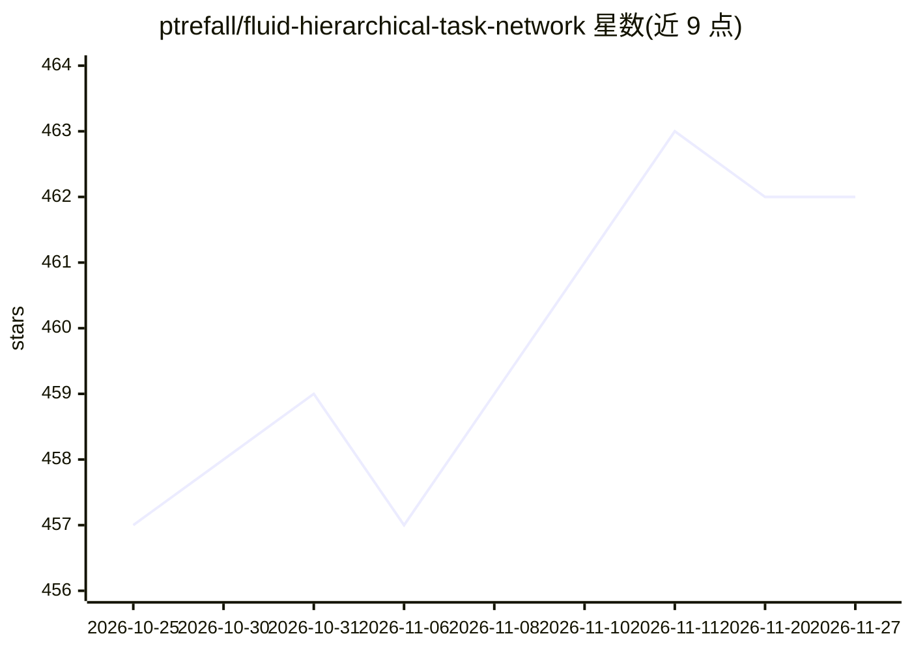

# ptrefall/fluid-hierarchical-task-network

⭐ 462 · C# · MIT · 推送 2026-11-26 · [GitHub](https://github.com/ptrefall/fluid-hierarchical-task-network) · 个人维护

**C# 编写的 HTN 规划器库：为游戏 AI 生成任务分解计划**

基于 Builder 模式的全序前向分解 HTN 规划器，采用 Troy Humphreys 在 GameAIPro 中描述的方法。核心概念包括 Compound Tasks（Selector/Sequence）、Primitive Tasks、Conditions、Operators 与 Effects 三类世界状态变更。提供 Domain Builder 以代码方式定义领域，支持部分规划、领域拼接与运行时领域插槽、仅在计划完成/失败或世界状态变化时重规划，并带分解日志调试与 160 个单元测试；提供 Unity Package Module 定义以便集成进 Unity 项目。

## 筛选速览

| 维度 | 判定 | 备注 |
|---|---|---|
| AI 角色 | `ai-native` | 本体是模型或模型工具 |
| 许可风险 | `permissive` | MIT |
| 部署形态 | `None` |  |
| 模型依赖 | — | README 未给出锁定关系 |
| 硬件要求 | — | 无带数字的原话,不猜 |
| 安装摩擦 | `low` | 无编译、无系统依赖或容器化 |
| 成熟度 | — | 结构信号不足 |

## 能力要点

- 全序前向分解 HTN 规划器，含 Domain Builder 代码化领域定义
- 支持部分规划、领域拼接与运行时领域插槽
- 提供分解日志（decomposition logging）用于调试
- 提供 Unity Package Module 定义与 160 个单元测试

## 适用场景

- 为游戏 NPC 编写可分解的层级任务行为规划
- 在 Unity 项目中集成 HTN 规划能力
- 通过子领域复用与插槽机制构建递归式行为结构

## 场景标签

 · 领域:游戏 AI/自动规划

## 证据(README 行号)

> L3: A simple HTN planner based around the principles of the Builder pattern, inspired by Fluid Behaviour Tree. Please ex
> L12: * Fluid HTN is a total-order forward decomposition planner, as described by Troy Humphreys in his GameAIPro article

## 星数曲线

2026-10-25 457 → 2026-11-27 462（+5）

---
*卡片 v1 · prompt 1.4 · 生成 2026-11-27 · 置信度 high · 依据 README sha `a1b2123eed42` · [字段定义](../../DATASET.md)*
