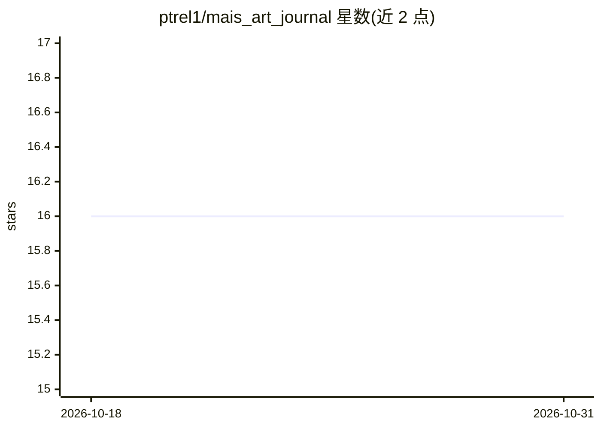

# ptrel1/mais_art_journal

⭐ 16 · Python · AGPL-3.0 · 推送 2026-10-23 · [GitHub](https://github.com/ptrel1/mais_art_journal) · 个人维护 · 中文 README

**给 MaiBot 聊天机器人的多模型文生图/图生图插件**

MaiBot 插件系统上的 QQ 聊天生图插件：按对话内容自动判断文生图或图生图，兼容 OpenAI、豆包（火山方舟）、Gemini、魔搭、DashScope、NovelAI、砂糖云、梦羽、硅基流动及本地 ComfyUI 等十种 API 格式。提供 /dr 命令系统、自拍模式（四种构图）、提示词 LLM 优化、群/私聊额度管理、结果缓存与自动撤回，并通过公开 API 供其他插件调用。依赖 MaiBot 宿主与 Python 3.12+，手动生图可独立使用，主动发图需 MaiTrace 日程配合。

## 筛选速览

| 维度 | 判定 | 备注 |
|---|---|---|
| AI 角色 | `ai-native` | 本体是模型或模型工具 |
| 许可风险 | `viral` | AGPL-3.0 |
| 部署形态 | `library` | 以包/库形式分发 |
| 模型依赖 | — | README 未给出锁定关系 |
| 硬件要求 | — | 无带数字的原话,不猜 |
| 安装摩擦 | `low` | 无编译、无系统依赖或容器化 |
| 成熟度 | — | 结构信号不足 |

## 能力要点

- 十种生图 API 格式接入，含本地 ComfyUI 工作流占位符替换
- 文生图/图生图自动识别，自拍模式含 auto/standard/mirror/photo 四种构图
- 按聊天流持久化的 /dr 命令系统与群/私聊生图额度管理
- 公开 generate_image API 供其他 MaiBot 插件调用

## 适用场景

- 让 QQ 群里的麦麦机器人按对话内容即时空文生图或改图
- 基于角色形象与日程生成自拍并发到空间或群
- 通过本地 ComfyUI 工作流在聊天中调用自建生图管线

## 场景标签

`图像生成` · 领域:内容生成

## 证据(README 行号)

> L3: 基于 MaiBot 的智能多模型图片生成插件，支持文生图和图生图自动识别。兼容原生 NovelAI、OpenAI、OpenAI-Chat、豆包（火山方舟）、Gemini、魔搭、硅基流动、砂糖云、梦羽、智谱 GLM、阿里百炼 Dash
> L9: - **文生图**: 根据对话内容自动生成图片

## 星数曲线

2026-10-18 16 → 2026-10-31 16（+0）

---
*卡片 v1 · prompt 1.4 · 生成 2026-10-30 · 置信度 mid · 依据 README sha `8777169e8118` · [字段定义](../../DATASET.md)*
