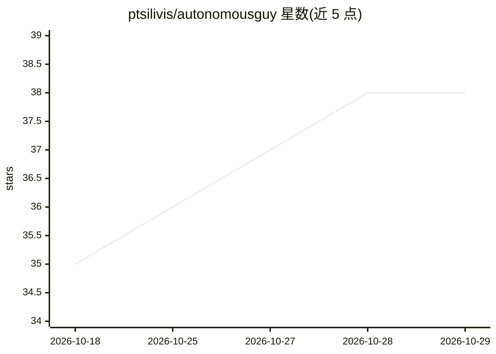

# ptsilivis/autonomousguy

⭐ 38 · HTML · MIT · 推送 2026-07-06 · [GitHub](https://github.com/ptsilivis/autonomousguy) · [官网](https://panostsilivis.com/autonomousguy/) · 个人维护

**面向汽车嵌入式工程师的 AI 技能集（AUTOSAR/MISRA/ISO 26262）**

开源的 Agent Skills 技能包，为 Copilot、Claude Code、Cursor 等 AI 编程工具提供汽车嵌入式领域上下文：10 个模式感知技能覆盖 ECU 软件生命周期，包括代码库结构分析（生成 CODEBASE_MAP.md）、AUTOSAR SWC/BSW 设计、MISRA C:2025 审计、ISO 26262 HARA 与 ASIL 需求、MC/DC 单元测试生成与嵌入式调试等。通过 npx skills 命令安装，技能落到各 agent 原生目录。引用 MISRA/ISO 标准时仅转述意图，不复制规范文本，实际项目需持有标准授权副本。

## 筛选速览

| 维度 | 判定 | 备注 |
|---|---|---|
| AI 角色 | `ai-knowledge` | 知识聚合/清单类 |
| 许可风险 | `permissive` | MIT |
| 部署形态 | `library` | 以包/库形式分发 |
| 模型依赖 | — | README 未给出锁定关系 |
| 硬件要求 | — | 无带数字的原话,不猜 |
| 安装摩擦 | `low` | 无编译、无系统依赖或容器化 |
| 成熟度 | — | 结构信号不足 |

## 能力要点

- 10 个模式感知技能覆盖 ECU 软件生命周期
- Classic/Adaptive AUTOSAR 双平台支持，按输入概念切换
- MISRA C:2025 审计与 ISO 26262 HARA/ASIL 需求追踪
- 兼容 Claude Code、Copilot、Cursor、Codex、Gemini CLI 等 agent

## 适用场景

- 给 AI 编程助手补充 AUTOSAR/MISRA/功能安全领域知识
- 在新项目上先做代码库结构分析再进入开发任务
- 对 C 代码做 MISRA C:2025 合规审计与代码评审

## 场景标签

`代码审查` `提示工程` · 领域:Agent 开发

## 证据(README 行号)

> L7: Open-source AI agent skills for embedded automotive engineers - AUTOSAR, MISRA C, ISO 26262 - that give Copilot and 
> L23: 10 mode-aware skills covering the ECU software lifecycle. Each skill routes from your input to the right sub-workfl

## 星数曲线

2026-10-18 35 → 2026-10-29 38（+3）

---
*卡片 v1 · prompt 1.4 · 生成 2026-10-25 · 置信度 high · 依据 README sha `1ad0f4ec712d` · [字段定义](../../DATASET.md)*
