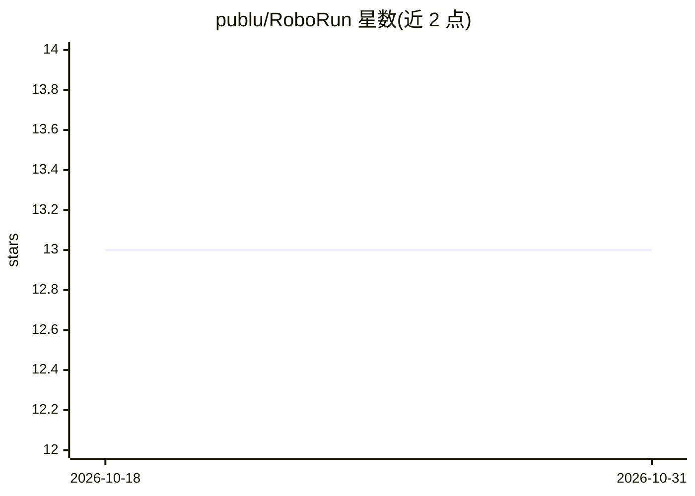

# publu/RoboRun

⭐ 13 · Python · MIT · 推送 2026-08-26 · [GitHub](https://github.com/publu/RoboRun) · [官网](https://roborun.dev) · 个人维护

**机器人行为运行时：热重载 Python 驱动 ROS 1/2 机器人并加密记录运行**

面向机器人开发者的 Python 运行时与基础设施：用 see/move/ask 原语在单文件中编写机器人行为，保存即热重载，同一份代码可运行于浏览器仿真、MuJoCo、webcam 或经 rosbridge/DDS 连接的真实机器人（Unitree Go2/G1、TurtleBot、Isaac Sim、Gazebo）。LLM 调用（Anthropic/OpenAI/Gemini/Ollama）为可选层级，控制回路本身 10 Hz 无 LLM。内置 MCP 服务器供 Claude/Codex 等 agent 接入。每次运行录制为 MCAP 文件，以哈希链+Merkle 根+Ed25519 签名+RFC 3161 时间戳实现防篡改与可验证回放。pip 安装，无需本机装 ROS。

## 筛选速览

| 维度 | 判定 | 备注 |
|---|---|---|
| AI 角色 | `ai-enhanced` | 去掉 AI 部分产品仍成立 |
| 许可风险 | `permissive` | MIT |
| 部署形态 | `library` | 以包/库形式分发 |
| 模型依赖 | local-ok | 支持本地模型 |
| 硬件要求 | — | 无带数字的原话,不猜 |
| 安装摩擦 | `low` | 无编译、无系统依赖或容器化 |
| 成熟度 | — | 结构信号不足 |

## 能力要点

- 行为文件保存即热重载，出错不崩溃运行时
- 同一行为文件跨仿真与真实硬件运行（rosbridge/DDS，本机免装 ROS）
- MCAP 录制 + Merkle 根 + Ed25519 + RFC 3161 可信时间戳的防篡改黑匣子
- 运行时整体暴露为 MCP 服务器，Claude/Codex 一行接入

## 适用场景

- 用简短 Python 驱动仿真或真实机器人，免去 ROS 工具链
- 让 AI agent 通过 MCP 操作和修改运行中的机器人
- 为机器人运行留下可离线验证的防篡改证据记录
- 跨机器人机队用 DuckDB/CLIP 检索历史运行

## 场景标签

 · 领域:机器人/物理 AI 基础设施

## 证据(README 行号)

> L5:  The base layer for coding robots: <code>see / move / ask</code> primitives, hot-reload Python behaviors, the same f
> L138: It's not a chat-controlled robot: behaviors run at 10 Hz with **no LLM in the loop**, and MCP, the REST API, and `
> L71: Press `M` in the flight deck (or `POST /api/run/record/start`) and everything — camera keyframes, YOLO detections, 

## 星数曲线

2026-10-18 13 → 2026-10-31 13（+0）

---
*卡片 v1 · prompt 1.4 · 生成 2026-10-31 · 置信度 mid · 依据 README sha `bd0eb73676bb` · [字段定义](../../DATASET.md)*
