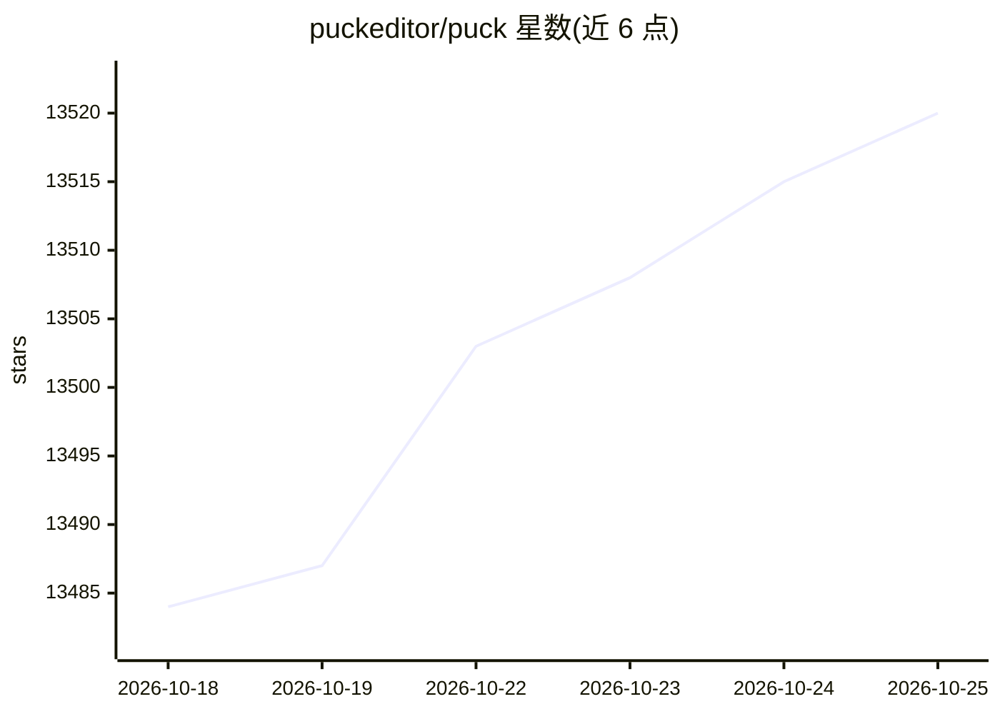

# puckeditor/puck

⭐ 13,528 · TypeScript · MIT · 推送 2026-10-23 · [GitHub](https://github.com/puckeditor/puck) · [官网](https://puckeditor.com) · 组织维护

**React 开发者的可视化拖拽页面编辑器**

Puck 是一个模块化的 React 可视化编辑器，本身以 React 组件形式提供，可在自有应用中嵌入并基于自己的 React 组件构建拖拽式编辑体验，兼容 Next.js 等环境，数据由使用者自持、无供应商锁定。采用 MIT 许可，可用于内部系统与商业应用。通过 npm 安装 @puckeditor/core，或用 create-puck-app 脚手架生成预配置应用，官方提供 Next.js 与 React Router v7 两种 recipe，另设文档、Demo、Discord 社区与付费咨询渠道。

## 筛选速览

| 维度 | 判定 | 备注 |
|---|---|---|
| AI 角色 | `ai-ecosystem` | LLM/agent 周边工具 |
| 许可风险 | `permissive` | MIT |
| 部署形态 | `library` | 以包/库形式分发 |
| 模型依赖 | — | README 未给出锁定关系 |
| 硬件要求 | — | 无带数字的原话,不猜 |
| 安装摩擦 | `low` | 无编译、无系统依赖或容器化 |
| 成熟度 | — | 结构信号不足 |

## 动量与使用信号

- 维护:`active` — 距上次 push 2.1 天,年发版 10,85 位贡献者
- 涨星:近 1 天 **+3**(自 20261016 起算)
- 安装:npm 包 `@puckeditor/core` 月下载 1,168,051

## 能力要点

- 以 React 组件形式嵌入自有应用，支持自定义拖拽体验
- 兼容 Next.js、React Router 等 React 环境
- MIT 许可，可用于商业应用
- create-puck-app 提供预配置应用模板

## 适用场景

- 在 React/Next.js 应用中搭建可视化页面搭建能力
- 让非开发人员通过拖拽方式编辑页面内容
- 基于自有组件库构建内部内容管理系统

## 场景标签

 · 领域:Web 开发工具/低代码

## 证据(README 行号)

> L15: Puck is a modular, open-source visual editor for React.js. You can use Puck to build custom drag-and-drop experienc
> L17: Because Puck is just a React component, it plays well with all React.js environments, including Next.js. You own yo
> L19: Puck is also licensed under MIT, making it suitable for both internal systems and commercial applications.

## 星数曲线

2026-10-18 13,484 → 2026-10-25 13,520（+36）

---
*卡片 v1 · prompt 1.4 · 生成 2026-10-18 · 置信度 high · 依据 README sha `d7d92601b48f` · [字段定义](../../DATASET.md)*
