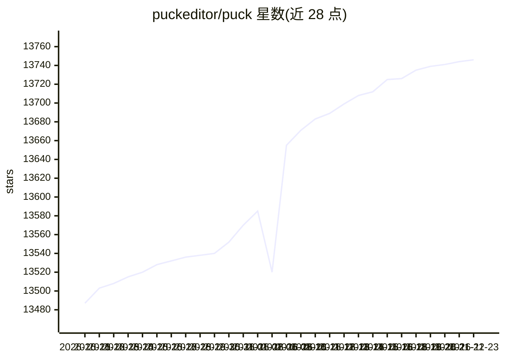

# puckeditor/puck

⭐ 13,746 · TypeScript · MIT · 推送 2026-11-21 · [GitHub](https://github.com/puckeditor/puck) · [官网](https://puckeditor.com) · 组织维护

**给 React 应用嵌入拖拽式可视化页面编辑器的开发库**

Puck 是面向 React 的开源可视化编辑器，以 React 组件形式嵌入现有应用，开发者使用自己的组件搭建拖拽式页面构建界面，组件与数据归属用户自身。核心为 @puckeditor/core 包，提供编辑器与渲染两个入口；可选接入 Puck Cloud 托管后端，含页面存储（版本历史与数据迁移）、托管认证与 AI 生成界面模块，通过 CLI 按需添加。MIT 许可，允许内部与商业使用。

## 筛选速览

| 维度 | 判定 | 备注 |
|---|---|---|
| AI 角色 | `ai-enhanced` | 去掉 AI 部分产品仍成立 |
| 许可风险 | `permissive` | MIT |
| 部署形态 | `library` | 以包/库形式分发 |
| 模型依赖 | — | README 未给出锁定关系 |
| 硬件要求 | — | 无带数字的原话,不猜 |
| 安装摩擦 | `low` | 无编译、无系统依赖或容器化 |
| 成熟度 | — | 结构信号不足 |

## 动量与使用信号

- 维护:`active` — 距上次 push 2.1 天,年发版 10,85 位贡献者
- 涨星:近 1 天 **+3**(自 20261016 起算)
- 安装:npm 包 `@puckeditor/core` 月下载 1,168,051

## 能力要点

- 以 React 组件嵌入现有应用，使用开发者自己的组件
- Editor 与 Render 分离，同一 config 既可编辑也可渲染页面
- Puck Cloud 可选模块化后端：页面存储、认证、AI 模块按需添加
- MIT 许可，允许内部与商业使用

## 适用场景

- 在现有 React 应用中嵌入页面搭建能力
- 让非技术用户用拖拽方式用组件库生成页面
- 为内容管理场景搭建自托管的页面构建器

## 场景标签

 · 领域:前端开发工具/低代码

## 证据(README 行号)

> L15: Puck is an open-source visual editor for React. Build drag-and-drop interfaces with your own components.
> L17: Embed Puck as a React component in your existing application. You own your components and data, with no vendor lock
> L81: Puck AI is an AI agent for Puck for generating interfaces directly from the editor.

## 星数曲线

2026-10-21 13,487 → 2026-11-23 13,746（+259）

---
*卡片 v1 · prompt 1.4 · 生成 2026-11-22 · 置信度 high · 依据 README sha `e731083b5143` · [字段定义](../../DATASET.md)*
