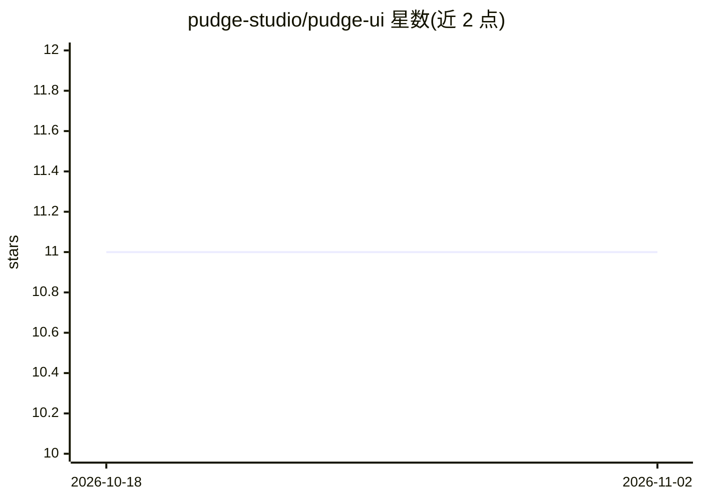

# pudge-studio/pudge-ui

⭐ 11 · TypeScript · MIT · 推送 2026-09-20 · [GitHub](https://github.com/pudge-studio/pudge-ui) · [官网](https://ui.pudgestudio.com) · 组织维护

**写给编码代理的 2000 年代拟物化 UI 设计规范**

一份面向编码代理（coding agents）的 UI 设计规范文档，而非组件库：没有可安装的组件包。93 个组件覆盖按钮、拨盘、滑块、读数等 11 类，每个组件规格包含物理原型（Sony Walkman、iPod 点击轮、Nikon 拨盘）、机械原理、精确 CSS 配方与实现约束，并以 6 种材质表面（拉丝金属、铬、橡胶等）和三层阴影深度模型约束拟物细节。使用方式是把规格交给编码代理，由其在任意技术栈（React Native、SwiftUI、Flutter、纯 CSS 等）中实现；也提供 MCP server 供 Claude Code、Cursor 等接入。MIT 许可（名称与吉祥物另作品牌声明）。

## 筛选速览

| 维度 | 判定 | 备注 |
|---|---|---|
| AI 角色 | `ai-knowledge` | 知识聚合/清单类 |
| 许可风险 | `permissive` | MIT |
| 部署形态 | `None` |  |
| 模型依赖 | — | README 未给出锁定关系 |
| 硬件要求 | — | 无带数字的原话,不猜 |
| 安装摩擦 | `low` | 无编译、无系统依赖或容器化 |
| 成熟度 | — | 结构信号不足 |

## 能力要点

- 93 个组件规格，每条含物理原型、机械原理、精确 CSS 与约束规则
- 技术栈无关：同一规格可由代理在 React Native、SwiftUI、Jetpack Compose、Flutter、纯 CSS 中实现
- 6 种物理材质配方与三层阴影深度模型
- 提供 MCP server 接入 Claude Code、Cursor 等编码代理工具

## 适用场景

- 让编码代理按统一拟物规范在任意技术栈构建 2000 年代风格界面
- 通过 MCP 在 Claude Code 或 Cursor 中直接调用组件规格
- 复刻 iPod、Walkman、DJ 台等复古硬件界面的视觉与交互细节

## 场景标签

 · 领域:UI 设计系统

## 证据(README 行号)

> L7: A design system for 2000s-era consumer-electronics interfaces, written for coding agents.
> L11: pudge-ui is a specification, not a component library. There's no package to install and no React components to impo

## 星数曲线

2026-10-18 11 → 2026-11-02 11（+0）

---
*卡片 v1 · prompt 1.4 · 生成 2026-11-01 · 置信度 high · 依据 README sha `8cb9bc53287f` · [字段定义](../../DATASET.md)*
