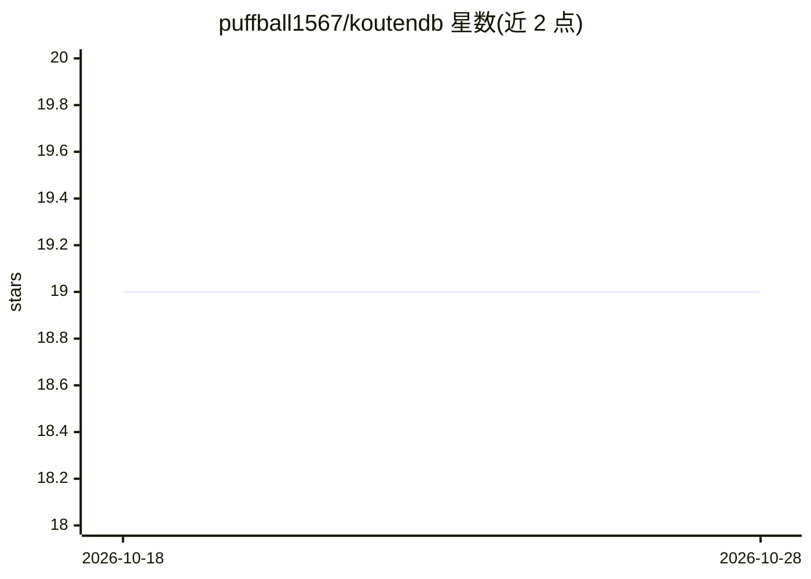

# puffball1567/koutendb

⭐ 19 · Nim · Apache-2.0 · 推送 2026-09-25 · [GitHub](https://github.com/puffball1567/koutendb) · [官网](https://puffball1567.github.io/koutendb/) · 个人维护

**面向 RAG/AI 检索的局部性优先文档+向量数据库**

KoutenDB 是用 Nim 编写的嵌入式/自托管文档与向量数据库：应用将相关数据放入显式 ring 坐标，读取时先按 ring 缩小工作集，再做精确余弦向量排序、结构化过滤与投影。面向构建 RAG、AI 检索及租户隔离 Web 服务的开发者。支持子环捆绑读取、dump/import-jsonl 迁移、三节点集群与 TLS 认证服务端；已发布 Rust/JS/PHP/Python/C++/Go 驱动。限制：pre-v1.0 内部 WAL 格式仍在加固，非 Nim 驱动发布进度不一。

## 筛选速览

| 维度 | 判定 | 备注 |
|---|---|---|
| AI 角色 | `ai-ecosystem` | LLM/agent 周边工具 |
| 许可风险 | `permissive` | Apache-2.0 |
| 部署形态 | `library` | 以包/库形式分发 |
| 模型依赖 | — | README 未给出锁定关系 |
| 硬件要求 | — | 无带数字的原话,不猜 |
| 安装摩擦 | `medium` | 含编译或系统依赖之一 |
| 成熟度 | `idea` | |

## 能力要点

- ring 一级检索边界：先定位局部范围再做向量排序与过滤
- 子环捆绑读取（各子环独立 limit 与排序）
- 72 小时三节点强持久集群运行验证（4,213,187 次操作零客户端错误）
- 提供 ghcr.io Docker 镜像与已发布的多语言驱动

## 适用场景

- RAG 检索前按租户/产品/文档族缩小候选集以降低 token 消耗
- 在 Nim 应用中嵌入式使用文档+向量存储
- 自托管 TLS 认证的持久化数据库服务端
- 租户隔离的 Web 系统数据存储与备份边界管理

## 场景标签

`向量数据库` · 领域:知识与检索

## 证据(README 行号)

> L3: **KoutenDB is a locality-first document and vector database.** It lets an
> L9: memory, and tokens a request must process. KoutenDB is useful for RAG and AI

## 星数曲线

2026-10-18 19 → 2026-10-28 19（+0）

---
*卡片 v1 · prompt 1.4 · 生成 2026-10-28 · 置信度 mid · 依据 README sha `a72e3189cf04` · [字段定义](../../DATASET.md)*
