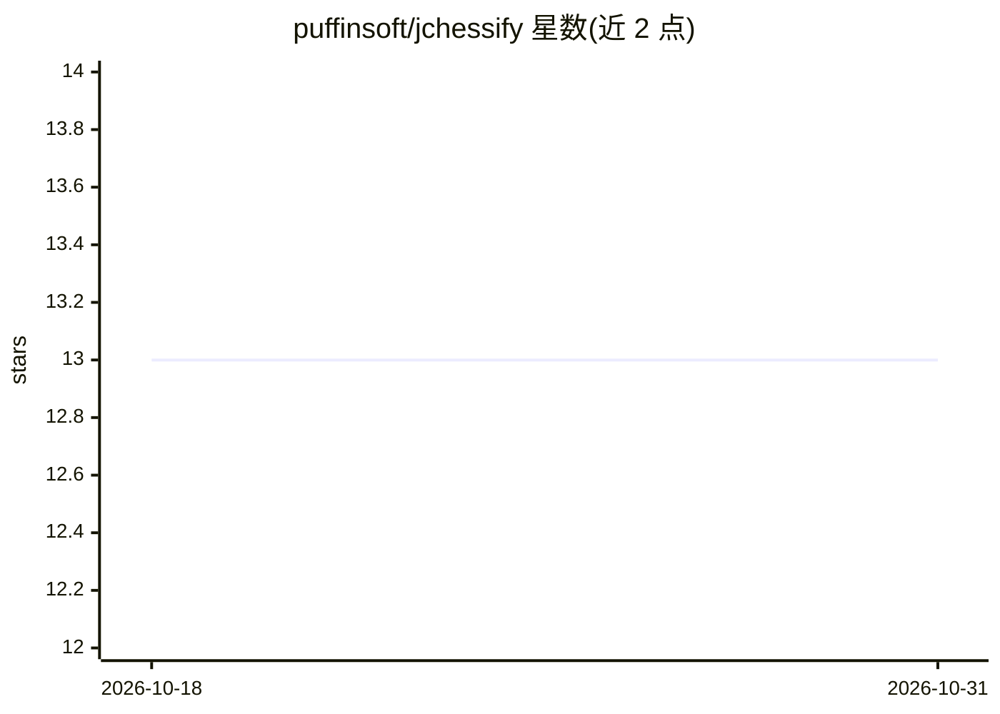

# puffinsoft/jchessify

⭐ 13 · Java · MIT · 推送 2025-11-27 · [GitHub](https://github.com/puffinsoft/jchessify) · [官网](https://puffinsoft.github.io/jchessify/) · 个人维护

**Java 国际象棋引擎框架：快速搭建带搜索与评估的引擎**

面向 Java 开发者的国际象棋引擎框架：内置 minimax 搜索与 alpha-beta 剪枝，支持自定义评估函数（默认提供基于子力价值的 PieceValueEvaluator），并带自有格式的开局库读取与下一步走法查找。开发者通过 Maven 引入依赖，用少量代码即可加载 FEN 棋局、设定搜索深度并获得最佳走法。棋盘与走法逻辑由 bhlangonijr/chesslib 提供。

## 筛选速览

| 维度 | 判定 | 备注 |
|---|---|---|
| AI 角色 | `ai-native` | 本体是模型或模型工具 |
| 许可风险 | `permissive` | MIT |
| 部署形态 | `None` |  |
| 模型依赖 | — | README 未给出锁定关系 |
| 硬件要求 | — | 无带数字的原话,不猜 |
| 安装摩擦 | `low` | 无编译、无系统依赖或容器化 |
| 成熟度 | — | 结构信号不足 |

## 能力要点

- minimax 搜索与 alpha-beta 剪枝
- 可插拔的自定义评估函数接口（Evaluator）
- 开局库支持（自有格式，附带默认开局库）
- 通过 Apache Maven 以依赖形式安装

## 适用场景

- 快速编写 Java 国际象棋引擎并专注高层逻辑
- 实现自定义局面评估策略并接入搜索框架
- 通过开局库为引擎提供开局走法

## 场景标签

 · 领域:游戏 AI/棋类引擎

## 证据(README 行号)

> L5:  Java chess engine framework
> L20: Move bestMove = engine.getBestMove(chessBoard);

## 星数曲线

2026-10-18 13 → 2026-10-31 13（+0）

---
*卡片 v1 · prompt 1.4 · 生成 2026-10-31 · 置信度 mid · 依据 README sha `877cdf012018` · [字段定义](../../DATASET.md)*
