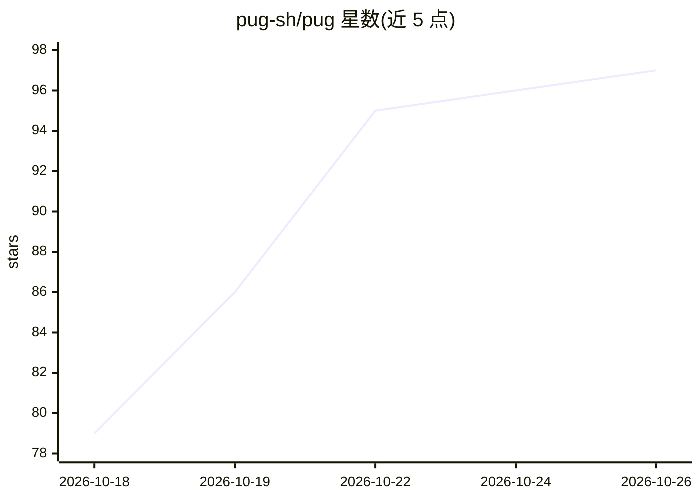

# pug-sh/pug

⭐ 97 · Go · NOASSERTION · 推送 2026-10-25 · [GitHub](https://github.com/pug-sh/pug) · [官网](https://pug.sh) · 组织维护

**开源产品分析平台：事件采集与漏斗、留存、趋势分析**

用 Go 编写、基于 PostgreSQL/ClickHouse/NATS 的自托管产品分析平台：通过 NATS 管道采集事件并自动富化地理位置、UA、机器人检测与归因；提供 Web 分析总览、实时世界地图、用户画像、趋势/漏斗/留存/细分/用户流洞察，以及可组合的仪表盘。支持 GDPR/DPDP 数据主体擦除。安装方式为 make build 构建二进制，附带 CLI 演示数据填充命令（默认重置数据库）。仓库主题标签含 ai/assistant/mcp。

## 筛选速览

| 维度 | 判定 | 备注 |
|---|---|---|
| AI 角色 | `ai-enhanced` | 去掉 AI 部分产品仍成立 |
| 许可风险 | `none` | NOASSERTION |
| 部署形态 | `None` |  |
| 模型依赖 | — | README 未给出锁定关系 |
| 硬件要求 | — | 无带数字的原话,不猜 |
| 安装摩擦 | `low` | 无编译、无系统依赖或容器化 |
| 成熟度 | — | 结构信号不足 |

## 能力要点

- NATS 事件采集管道，自动富化 geo/UA/机器人检测/归因
- 趋势、漏斗、留存、细分、用户流（Sankey）等洞察与仪表盘
- GDPR/DPDP 数据主体擦除
- 实时世界地图展示访客与事件

## 适用场景

- 自托管替代 SaaS 做产品行为分析
- 通过漏斗与留存分析用户转化
- 构建带实时访客地图的运营仪表盘
- 满足 GDPR/DPDP 数据擦除合规要求

## 场景标签

 · 领域:数据分析/产品分析

## 证据(README 行号)

> L7: Pug is an open-source product analytics platform. Capture events, identify the
> L11: Built in Go on PostgreSQL, ClickHouse, and NATS.

## 星数曲线

2026-10-18 79 → 2026-10-26 97（+18）

---
*卡片 v1 · prompt 1.4 · 生成 2026-10-23 · 置信度 mid · 依据 README sha `427af75f1301` · [字段定义](../../DATASET.md)*
