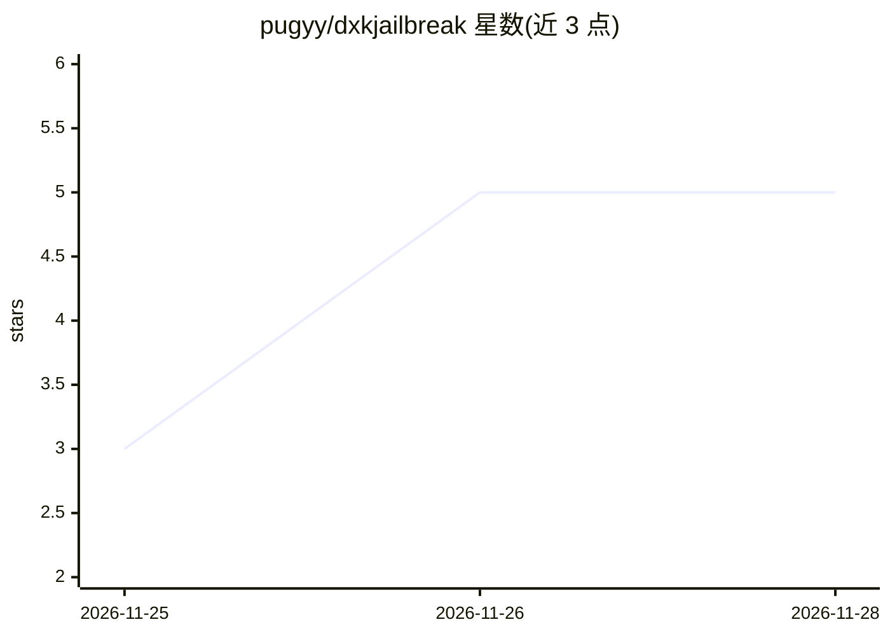

# pugyy/dxkjailbreak

⭐ 5 · JavaScript · MIT · 推送 2026-11-25 · [GitHub](https://github.com/pugyy/dxkjailbreak) · [官网](https://github.com/pugyy/dxkjailbreak/releases) · 个人维护 · 中文 README

**为 DeepSeek Harness 提供多域安全工作流预设的插件**

面向 DeepSeek Harness (DSH) 的工作流预设插件：将渗透测试、代码审计、逆向、内网、对抗样本、应急响应、云安全、CTF、资产测绘等 11 个安全研究方向合成为单张预设卡，附 24 页签设置控制台与 17 个子插件。核心机制包括 86 条宿主适配项（可自检、可逐条回滚）、四层上下文防衰减（周期重锚/尾部锚/子代理锚/注入块）、会话回退与回收站式删除。通过 git clone 后 node install.mjs 安装，需 DSH 0.2.1-rc.2~0.2.x 宿主；README 含指导用户让 AI 执行安装脚本而不审查源码的提示词模板。

## 筛选速览

| 维度 | 判定 | 备注 |
|---|---|---|
| AI 角色 | `ai-ecosystem` | LLM/agent 周边工具 |
| 许可风险 | `permissive` | MIT |
| 部署形态 | `desktop` | 安装包/桌面程序 |
| 模型依赖 | locked-api |  |
| 硬件要求 | — | 无带数字的原话,不猜 |
| 安装摩擦 | `low` | 无编译、无系统依赖或容器化 |
| 成熟度 | — | 结构信号不足 |

## 能力要点

- 单卡覆盖 11 个安全研究方向，按任务自动路由
- 86 条宿主适配项，支持自检、逐条回滚与状态页核验
- 24 页签设置控制台，22 个 RPC 后端接口
- 600+ 断言测试套件与四层适配链核验命令

## 适用场景

- 在授权范围内的渗透测试任务中切换多域工作流预设
- 安全研究中保持长会话上下文不漂移
- 对 DSH 宿主进行适配项管理与版本兼容排查

## 场景标签

`提示工程` `网络安全` · 领域:Agent 开发

## 证据(README 行号)

> L23: `dxkjailbreak` 是面向 **DeepSeek Harness (DSH)** 的工作流预设插件：把十一个安全研究方向合成一张单卡，再配一个带 24 个页签的设置页控制台。
> L29: |每种研究方向都要单独切模式、单独配技能|**单卡多域**：一张预设卡覆盖渗透 / 代码审计 / 逆向 / 内网 / 对抗样本 / 应急 / 云安全 / CTF / 资产测绘 / 注册反代 / 多任务编排，按任务自动换打法|
> L177: |DSH `0.2.1-rc.2`|✅ 全量适配（86 条中 74 条生效，12 条按其原因不适用）|

## 星数曲线

2026-11-25 3 → 2026-11-28 5（+2）

---
*卡片 v1 · prompt 1.4 · 生成 2026-11-24 · 置信度 mid · 依据 README sha `7c41046c3b62` · [字段定义](../../DATASET.md)*
