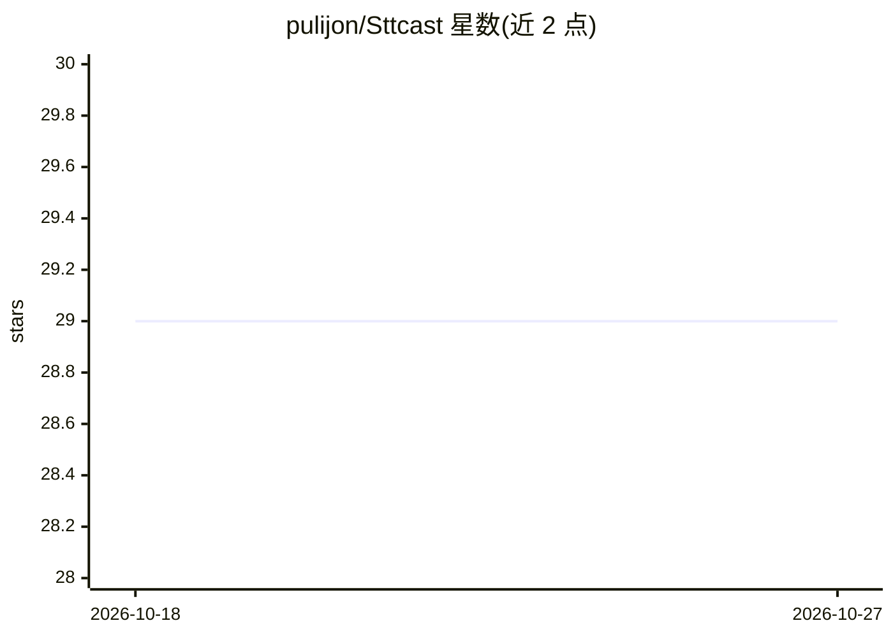

# pulijon/Sttcast

⭐ 29 · Jupyter Notebook · GPL-3.0 · 推送 2026-10-10 · [GitHub](https://github.com/pulijon/Sttcast) · 个人维护

**播客转写与语义检索套件：转写、说话人识别、RAG 搜索**

面向播客爱好者的自动转写系统：主引擎 WhisperX（基于 OpenAI Whisper、CUDA 加速）配合 Pyannote 做说话人分离聚类，可选用 CPU-only 的 Vosk（仅西班牙语）。输出 HTML/SRT，含播放器与说话时长统计。五组件架构：FastAPI 网页管理界面、转写服务器、RAG 服务器（OpenAI embedding + GPT 回答与摘要）、SQLite+FAISS 上下文服务器、Flask 检索客户端。需 Python 3.10+、FFmpeg，GPU 为可选项；另提供 AWS EC2 GPU 云端自动化脚本。

## 筛选速览

| 维度 | 判定 | 备注 |
|---|---|---|
| AI 角色 | `ai-native` | 本体是模型或模型工具 |
| 许可风险 | `viral` | GPL-3.0 |
| 部署形态 | `library` | 以包/库形式分发 |
| 模型依赖 | — | README 未给出锁定关系 |
| 硬件要求 | — | 无带数字的原话,不猜 |
| 安装摩擦 | `medium` | 含编译或系统依赖之一 |
| 成熟度 | — | 结构信号不足 |

## 能力要点

- WhisperX + Pyannote 转写与说话人分离，CUDA 加速
- Vosk 备选引擎：CPU-only，仅西班牙语
- RAG 语义搜索：OpenAI embedding + FAISS + GPT 回答与自动摘要
- 说话人时长统计与 CSV 导出
- AWS EC2 GPU 云端自动化（两命令创建/销毁）

## 适用场景

- 将播客音频转成可检索的 HTML 文稿
- 定位某话题在哪期哪一分秒被讨论
- 统计各说话人发言时长
- 对转写内容做自然语言问答与自动摘要

## 场景标签

`语音识别` `RAG` `语义搜索` · 领域:知识与检索

## 证据(README 行号)

> L5: **STTCast** is a comprehensive suite for automatic podcast transcription, speaker identification (diarization), and 
> L9: - **WhisperX Transcription**: Primary transcription engine based on OpenAI Whisper with CUDA acceleration
> L47: - Embedding generation with OpenAI

## 星数曲线

2026-10-18 29 → 2026-10-27 29（+0）

---
*卡片 v1 · prompt 1.4 · 生成 2026-10-26 · 置信度 mid · 依据 README sha `a7fa9d6c3e26` · [字段定义](../../DATASET.md)*
