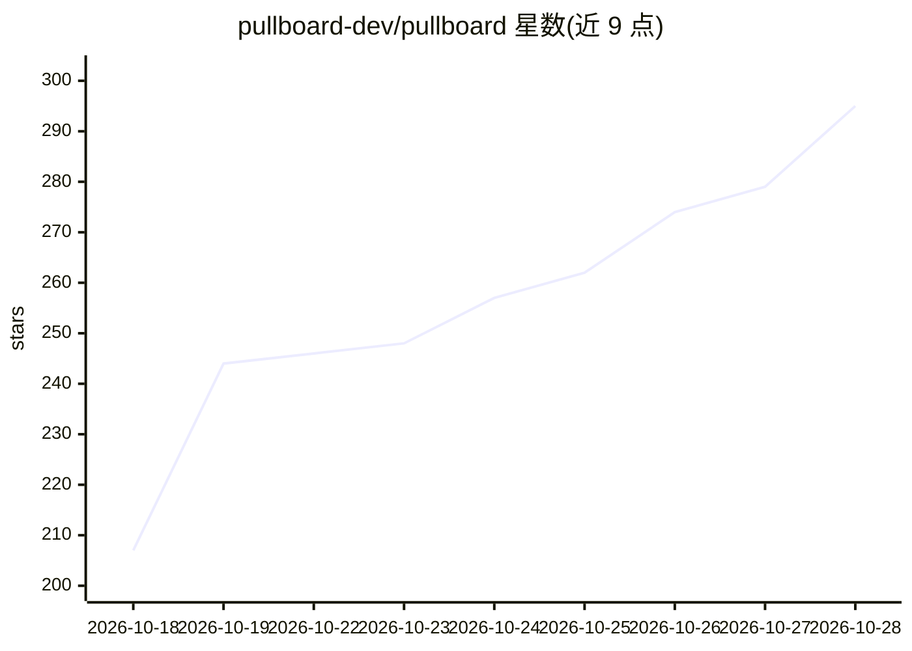

# pullboard-dev/pullboard

⭐ 295 · JavaScript · MIT · 推送 2026-10-27 · [GitHub](https://github.com/pullboard-dev/pullboard) · [官网](https://pullboard.dev) · 组织维护

**面向真实产品的自主开发代理编排工具：规格驱动、代理互验后合并**

运行在 git 仓库内的代理编排与治理工具：开发者把需求写成 SPEC.md 行、规则写成 DOCTRINE.md，由 git hook 等强制执行。构建代理在各自 worktree 车道中认领工作，提交须过绿色门禁，再由另一个验证代理核验该确切 commit 后才能合并。提供桌面板视图（Pullboard View）与手机端查看，代理通过 Shouts 机制向上传递仅属人类的决策。板数据存为 .git 内的单个 SQLite 文件，无账号、不调用模型、所有数据留在本地仓库。需 git 与 Node 22.13+，npm 全局安装。

## 筛选速览

| 维度 | 判定 | 备注 |
|---|---|---|
| AI 角色 | `ai-ecosystem` | LLM/agent 周边工具 |
| 许可风险 | `permissive` | MIT |
| 部署形态 | `library` | 以包/库形式分发 |
| 模型依赖 | — | README 未给出锁定关系 |
| 硬件要求 | — | 无带数字的原话,不猜 |
| 安装摩擦 | `medium` | 含编译或系统依赖之一 |
| 成熟度 | — | 结构信号不足 |

## 能力要点

- SPEC.md 规格行 + DOCTRINE.md 规则 + git hook 强制执行
- 每个代理独立 worktree 车道，提交须过门禁并由第二代理验证
- 板数据为 .git 内单个 SQLite 文件，无账号、不调用模型、不托管数据
- 捆绑 10 种项目蓝图（web 应用、库、iOS、数据管道等）

## 适用场景

- 多个编码代理并行开发同一仓库时避免冲突并保留决策记录
- 让构建与验证代理分工，只把需要人类拍板的决策递给自己
- 长期迭代项目中积累规格与规则，避免每次会话重新交代

## 场景标签

`多智能体` `编码 Agent` `代码审查` · 领域:Agent 开发

## 证据(README 行号)

> L3:  pullboard.dev · lives in your git repo · no account · no dependencies · never calls a model

## 星数曲线

2026-10-18 207 → 2026-10-28 295（+88）

---
*卡片 v1 · prompt 1.4 · 生成 2026-10-22 · 置信度 high · 依据 README sha `0bbbbadebd9a` · [字段定义](../../DATASET.md)*
