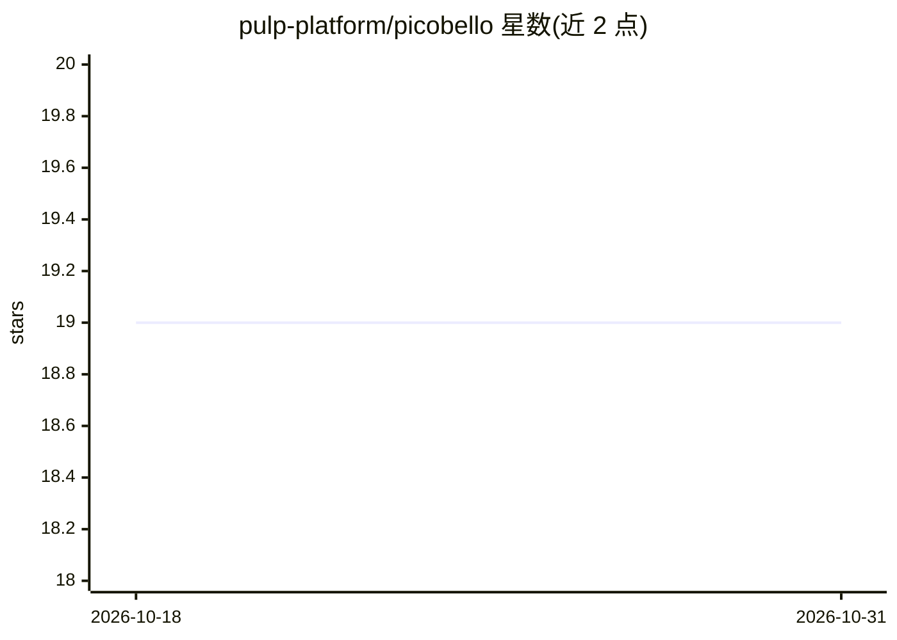

# pulp-platform/picobello

⭐ 19 · C · NOASSERTION · 推送 2026-06-10 · [GitHub](https://github.com/pulp-platform/picobello) · 组织维护

**面向 AI/ML 加速的开源硬件研究平台（RISC-V/NoC）**

PULP 项目（ETH Zurich 与博洛尼亚大学合作）下的开源研究平台，聚焦 AI 与机器学习加速的 SoC 设计。集成 Cheshire 主机系统、FlooNoC 片上网络与 Snitch 聚合核心，通过 Python 流程生成 RTL 与软件源码，支持编译 Snitch 软件测试与 GEMM 等应用、Questasim 仿真及内存转储结果验证。需安装 Bender、uv、LLVM 与 RISC-V GCC 工具链；硬件源码采用 Solderpad 0.51 许可，软件为 Apache 2.0。

## 筛选速览

| 维度 | 判定 | 备注 |
|---|---|---|
| AI 角色 | `ai-ecosystem` | LLM/agent 周边工具 |
| 许可风险 | `none` | NOASSERTION |
| 部署形态 | `None` |  |
| 模型依赖 | — | README 未给出锁定关系 |
| 硬件要求 | — | 无带数字的原话,不猜 |
| 安装摩擦 | `medium` | 含编译或系统依赖之一 |
| 成熟度 | — | 结构信号不足 |

## 能力要点

- 集成 Cheshire/FlooNoC/Snitch 的 RTL 代码生成流程（make all）
- 支持编译并运行 Snitch offload 示例与 GEMM 核等软件测试
- Questasim 仿真含批量模式、快速预载与 Python 结果验证脚本

## 适用场景

- 研究 AI/ML 硬件加速器的 RTL 设计与片上网络
- 在仿真中运行和验证 Snitch 聚合核心的算子内核
- 作为 PULP 生态教学与芯片研发的实验平台

## 场景标签

 · 领域:硬件/芯片设计

## 证据(README 行号)

> L3: *picobello* is an open-source research platform focusing on AI and Machine Learning acceleration.
> L5: *picobello* is developed as part of the PULP (Parallel Ultra-Low Power) project, a joint effort between ETH Zurich a

## 星数曲线

2026-10-18 19 → 2026-10-31 19（+0）

---
*卡片 v1 · prompt 1.4 · 生成 2026-10-29 · 置信度 high · 依据 README sha `49145e990569` · [字段定义](../../DATASET.md)*
