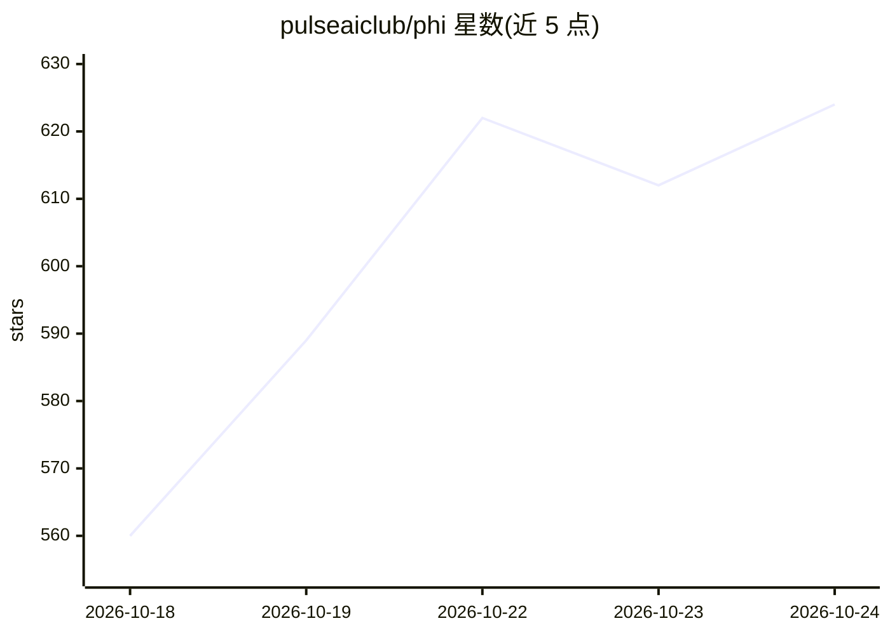

# pulseaiclub/phi

⭐ 635 · Go · MIT · 推送 2026-10-24 · [GitHub](https://github.com/pulseaiclub/phi) · [官网](https://pulseaiclub.github.io/) · 组织维护 · 中文 README

**终端里的快速编码 agent：TUI/无头运行，多模型接入**

Go 编写的终端编码 agent，提供 TUI 与 headless 两种模式：模型通过 read/write/edit/bash 等核心工具执行任务，支持 sub-agents、基于锚点的宽松编辑、权限门控、渐进式 MCP 与 PXB 扩展。内置 /diff 全屏 git 审查、/code 源码查看器、/branch 分支切换与按目录持久化的会话（JSONL）。支持 OpenAI / Anthropic / Gemini 路由，配置经 ~/.phi/config.yaml 与环境变量覆盖。发布二进制约 15 MB，首帧约 31 ms，空闲内存约 21 MB；另有 optimizer 功能需外部 TypeSafe 服务并将上下文外发。

## 筛选速览

| 维度 | 判定 | 备注 |
|---|---|---|
| AI 角色 | `ai-native` | 本体是模型或模型工具 |
| 许可风险 | `permissive` | MIT |
| 部署形态 | `library` | 以包/库形式分发 |
| 模型依赖 | — | README 未给出锁定关系 |
| 硬件要求 | — | 无带数字的原话,不猜 |
| 安装摩擦 | `medium` | 含编译或系统依赖之一 |
| 成熟度 | — | 结构信号不足 |

## 能力要点

- 模型以 read/write/edit/bash 等工具在终端内执行编码任务
- sub-agents、权限门控、渐进式 MCP、PXB 扩展
- 内置 /diff git 审查、/code 源码查看、/branch 分支切换
- headless 模式输出 JSONL 事件，可恢复会话

## 适用场景

- 在终端里让 agent 读写代码、修复测试并审查 git diff
- CI 或基准测试中无头运行单轮 agent 任务
- 通过 SKILL.md 技能目录为模型注入可复用流程

## 场景标签

`编码 Agent` · 领域:编码与开发

## 证据(README 行号)

> L11: - 15 MB · ~31 ms · sub-agents · anchored sloppy edits · permission gate · progressive MCP · PXB extensions · native
> L70: The TUI gives the model four core tools — `read`, `write`, `edit`, and
> L285: phi run -p "fix the failing test in internal/tools"

## 星数曲线

2026-10-18 560 → 2026-10-24 624（+64）

---
*卡片 v1 · prompt 1.4 · 生成 2026-10-21 · 置信度 mid · 依据 README sha `85470f3b5eb3` · [字段定义](../../DATASET.md)*
