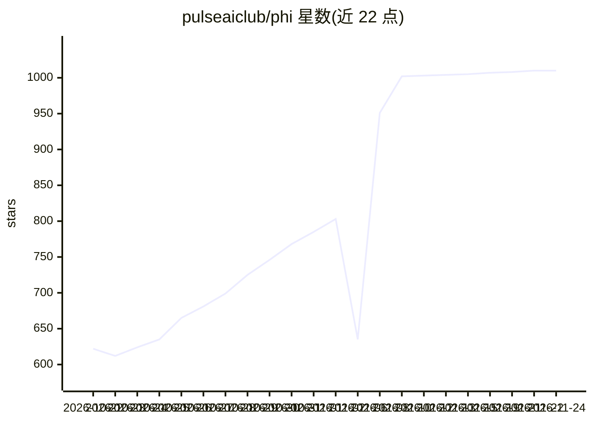

# pulseaiclub/phi

⭐ 1,013 · Go · MIT · 推送 2026-11-24 · [GitHub](https://github.com/pulseaiclub/phi) · [官网](https://pulseaiclub.github.io/) · 组织维护 · 中文 README

**面向开发者的终端编码 Agent TUI（Go 单二进制，含 MCP 与子 Agent）**

用 Go 编写的终端编码 Agent：TUI 中模型通过 read/write/edit/bash/grep 等工具读写代码与执行命令；支持子 Agent 任务、锚定式 sloppy edits、渐进式 MCP 服务器管理、PXB 扩展、会话持久化/fork/compact，以及内嵌 git diff 审查、源码查看器与分支切换。安装脚本部署约 15 MB 单二进制，启动时后台下载 fd/rg 搜索工具；模型经 OpenAI/Anthropic/Gemini 三种 API 协议路由，通过 config.yaml 或环境变量配置。

## 筛选速览

| 维度 | 判定 | 备注 |
|---|---|---|
| AI 角色 | `ai-native` | 本体是模型或模型工具 |
| 许可风险 | `permissive` | MIT |
| 部署形态 | `library` | 以包/库形式分发 |
| 模型依赖 | — | README 未给出锁定关系 |
| 硬件要求 | — | 无带数字的原话,不猜 |
| 安装摩擦 | `medium` | 含编译或系统依赖之一 |
| 成熟度 | — | 结构信号不足 |

## 能力要点

- 单二进制 TUI，模型通过 read/write/edit/bash 等工具操作代码库
- 内嵌 git diff 审查可向 Agent 递交行级备注，另带源码查看器与分支切换
- MCP 服务器管理与 PXB 扩展插件机制（phi mcp / phi plugin）
- 会话以 JSONL 持久化，支持 fork、compact 与 headless 运行（phi run）

## 适用场景

- 在终端里让 Agent 直接读写代码、跑命令完成修改
- 在 TUI 内审查 diff 并把行级备注交给 Agent 处理
- 用 headless 模式单次运行或续接会话执行任务

## 场景标签

`编码 Agent` · 领域:编码与开发

## 证据(README 行号)

> L77: The TUI gives the model four core tools — `read`, `write`, `edit`, and
> L162: Provider routing uses the explicit `api` field (`OpenAI` / `Anthropic` /
> L275: |`phi`|Start the interactive TUI|

## 星数曲线

2026-10-22 622 → 2026-11-24 1,010（+388）

---
*卡片 v1 · prompt 1.4 · 生成 2026-11-24 · 置信度 mid · 依据 README sha `795a5fa50dae` · [字段定义](../../DATASET.md)*
