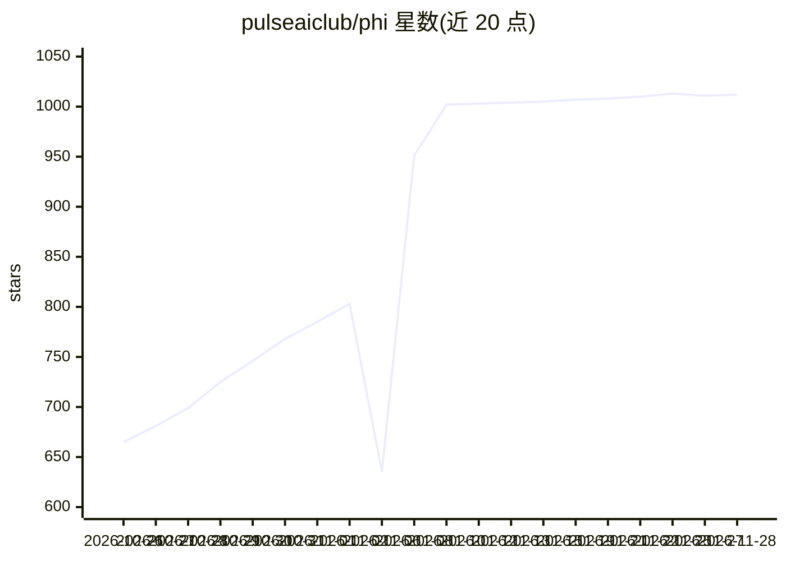

# pulseaiclub/phi

⭐ 1,012 · Go · MIT · 推送 2026-11-27 · [GitHub](https://github.com/pulseaiclub/phi) · [官网](https://pulseaiclub.github.io/) · 组织维护

**终端里的编码 agent TUI，读写编辑代码并管理 git**

用 Go 编写的终端编码 agent：启动 TUI 后模型通过 read/write/edit/bash/grep 等工具读写仓库并完成任务，支持子代理（sub-agents）、锚定式 sloppy edits、渐进式 MCP、扩展（PXB）与原生的 diff 审查、代码查看、分支切换面板。二进制约 15 MB，仅链接系统库（无 Node/Electron/Python）。面向在终端工作的开发者，通过配置文件或环境变量接入模型提供商。

## 筛选速览

| 维度 | 判定 | 备注 |
|---|---|---|
| AI 角色 | `ai-native` | 本体是模型或模型工具 |
| 许可风险 | `permissive` | MIT |
| 部署形态 | `library` | 以包/库形式分发 |
| 模型依赖 | — | README 未给出锁定关系 |
| 硬件要求 | — | 无带数字的原话,不猜 |
| 安装摩擦 | `medium` | 含编译或系统依赖之一 |
| 成熟度 | — | 结构信号不足 |

## 能力要点

- TUI 内置 read/write/edit/bash 等核心工具供模型操作代码仓库
- /diff 全屏 git 审查可将行内批注交给 agent；/code 提供语法高亮源码查看
- 子代理任务转录、会话按项目目录持久化为 JSONL，支持 fork/headless 续跑
- 渐进式 MCP 与 phi plugin 扩展管理（phi mcp / phi plugin 命令）

## 适用场景

- 在终端里让 agent 直接修改和审查本地代码
- 用 phi run 以 headless 模式跑单次 agent 循环
- 在 TUI 中切换 git 分支、浏览源码并把选中片段发给模型

## 场景标签

`编码 Agent` `代码审查` · 领域:编码与开发

## 证据(README 行号)

> L78: The TUI gives the model four core tools — `read`, `write`, `edit`, and
> L12: - 15 MB · ~31 ms · sub-agents · anchored sloppy edits · progressive MCP · PXB extensions · native diff review & cod

## 星数曲线

2026-10-26 665 → 2026-11-28 1,012（+347）

---
*卡片 v1 · prompt 1.4 · 生成 2026-11-28 · 置信度 mid · 依据 README sha `825535fe9a98` · [字段定义](../../DATASET.md)*
