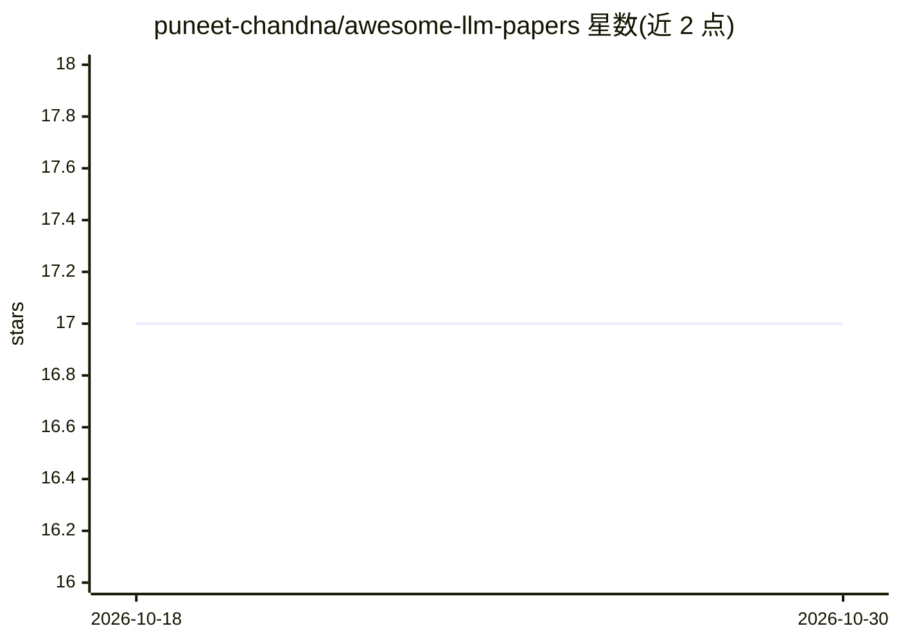

# puneet-chandna/awesome-llm-papers

⭐ 17 · Python · CC0-1.0 · 推送 2026-10-10 · [GitHub](https://github.com/puneet-chandna/awesome-llm-papers) · 个人维护

**LLM 研究论文精选清单：为研究者提供阅读路线与分类导航**

策展型 LLM 论文清单：收录 149 篇（2000–2026）具持续阅读价值的论文，按模型架构、推理与 Agent、效率、训练与对齐、多模态、RAG、安全、分析理论等 8 类组织，并另设 46 篇名人堂。提供每日精选、趋势主题表、按工作日的每周阅读路线，以及用 Mermaid 时间线图呈现的三条研究脉络（推理与 Agent、知识与记忆、高效计算），附里程碑与一手来源对照表。无安装运行内容，读者通过链接阅读论文；由社区投稿方式收录新条目。

## 筛选速览

| 维度 | 判定 | 备注 |
|---|---|---|
| AI 角色 | `ai-knowledge` | 知识聚合/清单类 |
| 许可风险 | `viral` | CC0-1.0 |
| 部署形态 | `None` |  |
| 模型依赖 | — | README 未给出锁定关系 |
| 硬件要求 | — | 无带数字的原话,不猜 |
| 安装摩擦 | `low` | 无编译、无系统依赖或容器化 |
| 成熟度 | — | 结构信号不足 |

## 能力要点

- 149 篇去重论文按 8 个类别组织，另设 46 篇 Hall of Fame
- Mermaid 时间线呈现三条研究脉络及里程碑一手来源对照
- 每周五篇按工作日标注的建议阅读序列
- 收录标准声明偏向独特贡献与持续阅读价值，跨实验室/类别/年份

## 适用场景

- 想系统了解 LLM 领域基础与突破论文时作为阅读起点
- 按研究问题（如长上下文、验证、MoE）寻找切入论文
- 跟踪 2017–2026 年推理、记忆、高效计算等研究脉络的演进

## 场景标签

`精选清单` · 领域:学习与行业

## 证据(README 行号)

> L5: > A curated list of seminal and breakthrough papers in Large Language Models.
> L87: **📋 All Papers (Chronological)** · **149 unique works · 2000–2026**

## 星数曲线

2026-10-18 17 → 2026-10-30 17（+0）

---
*卡片 v1 · prompt 1.4 · 生成 2026-10-29 · 置信度 high · 依据 README sha `bc09d125691d` · [字段定义](../../DATASET.md)*
